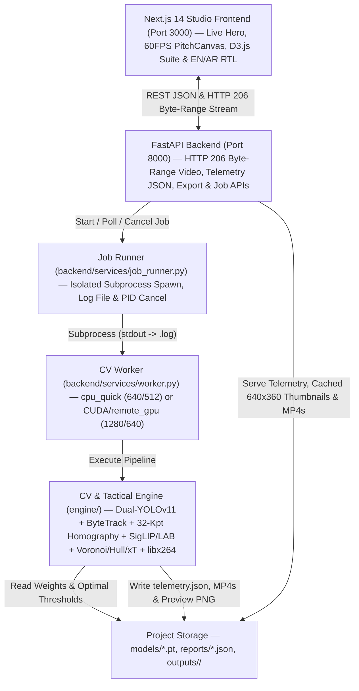

<div align="center">

# TacticalVision AI

**End-to-end football broadcast computer vision, 32-keypoint metric homography, and a synchronized 60FPS bilingual (`EN`/`AR`) tactical analytics studio.**

[](https://www.python.org/)
[](https://fastapi.tiangolo.com/)
[](https://nextjs.org/)
[](https://www.typescriptlang.org/)
[](https://d3js.org/)
[](https://docs.ultralytics.com/)
[](https://opencv.org/)
[](#interactive-analytics--zero-leak-localization-frontend)

[Architecture](#system-architecture--data-pipeline) · [Features](#key-capabilities--engineering-highlights) · [Engineering Highlights](#key-capabilities--engineering-highlights) · [Quick Start](#getting-started) · [API Reference](#rest-api-reference)

</div>

---

**TacticalVision AI** converts raw single-camera broadcast football footage into calibrated metric coordinates (`105m × 68m` FIFA pitch plane) and renders them inside a synchronized web studio. A two-stage Python CV pipeline extracts player/ball tracks, planar homography, team assignments, Voronoi territorial control, convex hull compactness, and Expected Threat (`xT`), while an isolated FastAPI + Next.js 14 stack streams byte-range H.264 video and signal-stabilized 60FPS interactive analytics.

<details>
<summary>📖 نظرة عامة على المشروع بالعربية (Arabic Executive Overview)</summary>

<div dir="rtl">

**TacticalVision AI** منصة هندسية متكاملة لتحليل مباريات كرة القدم انطلاقاً من فيديو البث التلفزيوني أحادي الكاميرا وصولاً إلى استوديو تحليلات تكتيكي تفاعلي يدعم اللغتين العربية (`RTL`) والإنجليزية (`LTR`) بالكامل.

يعالج محرك الرؤية الحاسوبية (`engine/`) اللقطات عبر نموذجي `YOLOv11` (رصد اللاعبين والحكام وحراس المرمى والكرة، بالإضافة إلى 32 نقطة مرجعية للملعب) مع تتبع `ByteTrack` ومرشح `Kalman` للكرة، ثم يحسب التحويل الهندسي `RANSAC Homography` لإسقاط الإحداثيات على ملعب فيفا القياسي (`105 × 68 م`) وتصنيف الفرق آلياً، قبل استخلاص مؤشرات السيطرة المكانية (`Voronoi`) وتراص الكتل (`Convex Hull`) وخطوط الدفاع والتهديد المتوقع (`xT`).

على طبقة الويب، يعزل خادم `FastAPI` (`backend/`) عمليات الاستدلال الثقيلة في عمليات فرعية مستقلة مع بث الفيديو عبر `HTTP 206` وإلغاء الوظائف عبر شجرة معرف العملية (`PID`)، بينما تطبق واجهة `Next.js 14` (`frontend/`) مُثبّت إشارة رقمياً (`radarStabilizer.ts`) لاستبعاد القفزات الشاذة وتنعيم الحركة عند `60FPS` إلى جانب مخططات `D3.js` التفاعلية.

</div>

</details>

---

## Interface Preview

The studio UI spans three synchronized views:
1. **Match Hub (`/`):** Animated 60FPS real-data Hero pitch replay (`HeroPitchVisual`), D3 radial KPI gauges, search/sort toolbar, and match library cards with cached thumbnails and upload/GPU job modal.
2. **Tactical War Room (`/match/[id]`):** Frame-locked H.264 broadcast/radar `<video>` player paired with a 60FPS 2D `PitchCanvas` (6 toggleable tactical layers), inline zero-overlap `PlayerSpotlight` inspector, `CoachBrief`, `D3MomentumStream`, and `D3PassNetworkPitch`.
3. **Telemetry & D3 Lab (`/match/[id]`):** Full-match KPI comparison, speed/defensive-line timelines, `D3ZonalControlMatrix` (`12 × 8`), sortable player table, and direct `CSV` / `JSON` data export.

> Screenshot directory initialized at [`docs/screenshots/`](docs/screenshots/.gitkeep). Capture desktop (`1440×900`) views of `/`, `/match/match_01_counter`, and the Telemetry Lab into that folder and uncomment the table below to display previews directly on GitHub.

<!-- Drop screenshots in docs/screenshots/ and uncomment:
| Match Hub & Live Hero Replay | War Room Video Sync & 2D Radar | Telemetry & D3 Analytics Lab |
| :---: | :---: | :---: |
|  |  |  |
-->

---

## Why TacticalVision AI?

| Engineering Challenge | How TacticalVision AI Solves It |
| :--- | :--- |
| **Raw Broadcast Perspective → Calibrated Metric Pitch** | Broadcast cameras pan, tilt, and zoom continuously, distorting pixel distances. A dedicated `YOLOv11m-pose` model extracts 32 FIFA pitch landmarks per frame, solves RANSAC planar homography with reprojection gating (`max_homography_reproj_m = 2.6m`) and EMA smoothing (`alpha = 0.25`), and projects every entity onto a `105m × 68m` plane. |
| **Non-Blocking Dual-Model CV & H.264 Transcoding** | Importing PyTorch and Ultralytics inside a web process slows API startup and risks request-loop starvation. `backend/main.py` keeps the API process lightweight and spawns `backend/services/worker.py` in an isolated subprocess with file-backed logging, PID-tree cancellation, and `cpu_quick` (`640px/512px`) vs `remote_gpu` (`1280px/640px`) execution paths. |
| **Trustworthy 60FPS Visualization & Bilingual Parity** | Raw frame-by-frame homography dropouts can produce sentinel clamps or jagged jumps on a raw canvas. Frontend signal stabilization (`radarStabilizer.ts`) filters glitch frames, bridges gaps, breaks discontinuous trajectories, and interpolates 60FPS sub-frames—rendered in a synchronized `EN (LTR)` / `AR (RTL)` studio with isolated numeric directionality (`<BidiNum>`). |

---

## System Architecture & Data Pipeline



### Telemetry Data Contract (`telemetry.json`)

All studio views, Canvas layers, D3 visualizations, and `CSV`/`JSON` exports read from a single schema produced by [`engine/pipeline.py`](engine/pipeline.py) and typed in [`frontend/src/lib/types.ts`](frontend/src/lib/types.ts):

```jsonc
{
  "summary": {
    "total_frames": 750,
    "fps": 25.0,
    "duration_s": 30.0,
    "possession_pct": { "team_0": 54.2, "team_1": 45.8 },
    "pitch_control_pct": {
      "team_0": 51.6,
      "team_1": 48.4,
      "team_0_zonal": { "defensive_third": 64.1, "middle_third": 49.8, "attacking_third": 38.2 }
    },
    "passes": { "team_0": 14, "team_1": 9 },
    "turnovers": 6,
    "expected_threat_xt": { "team_0": 0.0842, "team_1": 0.0519 },
    "avg_convex_hull_area_m2": { "team_0": 980.4, "team_1": 1045.1 },
    "top_speed_kmh": 31.4
  },
  "players": [
    {
      "track_id": 7, "team": 0, "role": "player",
      "distance_m": 112.6, "max_speed_kmh": 28.4, "avg_speed_kmh": 13.5,
      "sprints": 2, "passes_completed": 3, "xt_generated": 0.0214,
      "avg_pitch_xy": [61.2, 28.5], "frames_visible": 612
    }
  ],
  "passing_network": [
    { "team": 0, "from_id": 7, "to_id": 11, "count": 2 }
  ],
  "events": [
    { "type": "pass", "frame": 142, "time_s": 5.68, "team": 0, "from_id": 7, "to_id": 11, "start_xy": [55.1, 24.0], "end_xy": [72.4, 19.3], "distance_m": 17.9, "xt_delta": 0.0112 },
    { "type": "sprint", "frame": 210, "time_s": 8.40, "track_id": 11, "team": 0, "speed_kmh": 26.8 },
    { "type": "turnover", "frame": 388, "time_s": 15.52, "from_team": 1, "to_team": 0, "by_id": 4, "xy": [42.0, 39.1] }
  ],
  "heatmaps": { "team_0": "int[8][12]", "team_1": "int[8][12]" },
  "frames": [
    {
      "f": 0, "t": 0.0,
      "players": [{ "id": 7, "team": 0, "role": "p", "x": 48.2, "y": 31.4, "spd": 14.1 }],
      "ball": [51.0, 33.8],
      "vor": [52.3, 47.7],
      "def_x": { "0": 24.5, "1": 74.2 }
    }
  ],
  "match_info": {
    "source_video": "clip.mp4", "resolution": [1920, 1080], "fps": 25.0,
    "pitch_dimensions_m": [105, 68], "team_colors": { "0": "#1EC8FF", "1": "#FF5555" }
  },
  "engine_diagnostics": {
    "homography": { "valid_frames": 732, "rejected_frames": 18, "stability_rate_pct": 97.6, "mean_inlier_reproj_error_m": 0.48 },
    "ball_coverage_pct": 81.2, "processing_time_s": 48.3
  }
}
```

---

## Key Capabilities & Engineering Highlights

### Computer Vision & Spatial Engine (`engine/`)

- **Dual-YOLOv11 Detection & Tracking:** Runs fine-tuned `YOLOv11m` (`players_best.pt`) and 32-keypoint `YOLOv11m-pose` (`pitch_best.pt`) with per-class F1-calibrated thresholds loaded from [`reports/optimal_thresholds.json`](reports/optimal_thresholds.json) (`ball: 0.35`, `goalkeeper: 0.50`, `player: 0.60`, `referee: 0.45`, `nms_iou: 0.50`). Self-contained two-stage `PlayerByteTracker` (Kalman + Hungarian IoU association) and `KalmanBallTracker` with parabolic gap interpolation stabilize frame-to-frame identities.
- **32-Keypoint RANSAC Homography:** Maps visible pitch landmarks onto canonical `105m × 68m` coordinates in [`engine/homography.py`](engine/homography.py) using RANSAC planar homography (`max_homography_reproj_m = 2.6m`) and Exponential Moving Average smoothing (`homography_ema_alpha = 0.25`).
- **Unsupervised Team Classification:** Extracts jersey torso embeddings via `SigLIP` (`google/siglip-base-patch16-224`), reduces dimensionality with `UMAP` (falling back cleanly to `PCA`), and clusters teams via `KMeans(k=2)` with temporal majority-vote locking per `track_id`. In `cpu_quick` mode, the worker sets `HF_HUB_OFFLINE=1` and `TRANSFORMERS_OFFLINE=1` so [`engine/team_classifier.py`](engine/team_classifier.py) bypasses network model downloads and uses its deterministic CIE `LAB` non-green jersey fallback + `PCA`.
- **Tactical & Kinematic Analytics (`engine/tactics.py`):** Computes per-frame velocities (`km/h`, physically capped at `max_player_speed_kmh = 37.5`), sprints (`>= 24.0 km/h`), team Voronoi spatial control (`%`), outfield Convex Hull area (`m²`), virtual defensive lines (`def_x`), Karun Singh `12 × 8` Expected Threat (`XT_GRID`), `8 × 12` zonal presence heatmaps, and automated `pass` / `sprint` / `turnover` events.
- **H.264 Broadcast Rendering (`engine/renderer.py`):** Generates browser-playable `broadcast_analyzed.mp4` and `tactical_radar.mp4` encoded via `libx264` (`-preset fast -crf 22`).

<details>
<summary>Recorded Validation Metrics (Tesla T4 — reports/metrics_report.json)</summary>

| Model / Benchmark | Dataset Split / Setting | Recorded Metric |
| :--- | :--- | :--- |
| **Players / Ball Detector (`YOLOv11m`)** | `imgsz=1280`, overall | **`89.76%`** `mAP@50` · **`68.24%`** `mAP@50-95` |
| ↳ `player` class | Calibrated `conf=0.60`, `IoU=0.50` | **`99.43%`** `mAP@50` · **`0.9907`** F1 (`P=99.33%`, `R=98.81%`) |
| ↳ `referee` class | Calibrated `conf=0.45`, `IoU=0.50` | **`98.46%`** `mAP@50` · **`0.9888`** F1 |
| ↳ `goalkeeper` class | Calibrated `conf=0.50`, `IoU=0.50` | **`97.82%`** `mAP@50` · **`0.9630`** F1 |
| ↳ `ball` class | Calibrated `conf=0.35`, `IoU=0.50` | **`63.33%`** `mAP@50` · **`0.7368`** F1 (`P=95.45%`, `R=60.00%`) |
| **Pitch Landmarks (`YOLOv11m-pose`)** | 32 keypoints, validation | **`92.55%`** Pose `mAP@50` · **`86.77%`** `PCK@20px` · **`97.06%`** homography-ready frames |

</details>

### Frontend Signal Stabilization (`frontend/src/lib/radarStabilizer.ts`)

Raw single-camera homography dropouts can produce sentinel clamp coordinates at pitch boundaries (`-2.0` / `107.0` / `70.0`) or brief multi-player jumps. [`radarStabilizer.ts`](frontend/src/lib/radarStabilizer.ts) isolates the visualization layer from upstream jitter before anything reaches `<canvas>`:
- **Glitch Frame & Sentinel Filtering:** Flags frames with `>= 2` sentinel OOB clamps (`x <= -1.4 || x >= 106.4 || y <= -1.4 || y >= 69.4`) or sudden squad-wide median displacement spikes, rejecting corrupted frames cleanly instead of pinning players or trajectory lines to pitch corners.
- **2-Pass Kinematic Hampel Filter & Gap Bridging:** Removes isolated single-track coordinate teleports, linearly bridges short gaps (`<= 32` frames within plausible human sprint bounds), and applies a zero-phase 5-tap Gaussian kernel (`[0.10, 0.22, 0.36, 0.22, 0.10]`) strictly inside continuous segments (`breakBefore` marks true tracking discontinuities so selected-player ghost trails never stretch across gaps).
- **Ball Stabilization & EMA Damping:** Rejects ball corner-snap artifacts and multi-meter teleports, applies 3-tap smoothing, and damps Voronoi split, defensive lines (`def_x`), and outfield hull areas (`alpha = 0.24`).
- **60FPS Sub-Frame Interpolation & Hero Replay Selector:** `interpolateStabilizedFrame` smoothly blends positions between source frames (`25 FPS` → `60 FPS`), while `findBestHeroWindow` automatically picks the highest-tempo 7-second (`175`-frame) glitch-free sequence for the animated Match Hub Hero.

### Hybrid Execution & Process Isolation (`backend/`)

- **Zero-Import FastAPI Boot:** `backend/main.py` never imports `engine/`, PyTorch, or Ultralytics; heavy inference runs exclusively inside spawned [`backend/services/worker.py`](backend/services/worker.py) subprocesses.
- **Windows-Safe Logging & PID-Tree Cancellation:** [`backend/services/job_runner.py`](backend/services/job_runner.py) routes worker `stdout`/`stderr` to file-backed logs (`backend/jobs/{job_id}.log`, avoiding Windows 4KB `PIPE` deadlocks), writes atomic `.json.tmp` → `.json` progress updates parsed from `tqdm`, and exposes `POST /api/jobs/{job_id}/cancel` to kill the full worker process tree (`taskkill /PID <pid> /T /F` on Windows / `SIGTERM` on POSIX) and clean up temporary uploads and incomplete match folders.
- **Dual Precision & Auto-Bootstrapped FFmpeg:** Local `cpu_quick` jobs run at `det_imgsz=640` / `pitch_imgsz=512` (~4× faster on CPU), while CUDA or `remote_gpu` forwarding runs at full `1280` / `640`. On startup, the worker automatically resolves `imageio-ffmpeg` into `backend/bin/` if system `ffmpeg` is absent from `PATH`.

### Interactive Analytics & Zero-Leak Localization (`frontend/`)

- **Declarative `D3.js v7` Suite & High-Resolution Canvas:** Combines React SVG geometry with `d3` math (`D3PassNetworkPitch` with `12×8` xT overlay, `D3PlayerRadar`, `D3MomentumStream`, `D3ZonalControlMatrix`) alongside a `210×136` Voronoi `PitchCanvas` with crisp team-frontier seams and an inline docked zero-overlap `PlayerSpotlight` inspector.
- **Full `EN (LTR)` / `AR (RTL)` Parity:** [`frontend/src/lib/i18n.ts`](frontend/src/lib/i18n.ts) maintains exact `319`-key parity across English and Arabic, paired with a pre-hydration inline script in [`layout.tsx`](frontend/src/app/layout.tsx) (preventing RTL flash on reload), RTL-aware range scrubbers/timelines, and `<BidiNum>` `unicode-bidi: isolate` wrappers so metrics, resolutions, and coordinates never reverse in Arabic.

---

## Project Structure

```text
tactical-vision-ai/
├── backend/                        # FastAPI API server & subprocess orchestrator
│   ├── config.py                   # Pydantic v2 Settings (TV_ env prefix)
│   ├── main.py                     # App entry point, CORS headers & router mounting
│   ├── requirements.txt            # Lightweight FastAPI / httpx / Pillow dependencies
│   ├── models/schemas.py           # MatchCard & JobStatus Pydantic contracts
│   ├── routers/                    # matches, telemetry, video (HTTP 206), export, assets, upload
│   └── services/                   # match_service, video_streamer, job_runner, worker
├── engine/                         # Dual-YOLOv11 CV & tactical computation package
│   ├── config.py                   # FIFAPitchConfig (32 kpts), XT_GRID (12x8) & EngineConfig
│   ├── detector.py                 # Dual YOLOv11m inference (entities + 32-keypoint pose)
│   ├── tracker.py                  # PlayerByteTracker & KalmanBallTracker
│   ├── homography.py               # RANSAC planar homography & EMA smoothing
│   ├── team_classifier.py          # SigLIP+UMAP+KMeans with offline LAB+PCA fallback
│   ├── tactics.py                  # Kinematics, Voronoi, Convex Hull, xT & event detection
│   ├── renderer.py                 # Broadcast/radar overlays & libx264 H.264 encoding
│   └── pipeline.py                 # Two-pass match pipeline & telemetry.json writer
├── frontend/                       # Next.js 14 App Router Studio UI
│   ├── package.json                # Next.js 14, React 18, D3 v7, Framer Motion, Recharts
│   └── src/
│       ├── app/                    # Match Hub (/), War Room & Telemetry Lab (/match/[id])
│       ├── components/             # PitchCanvas, VideoPlayer, PlayerSpotlight, UploadModal, d3/
│       ├── context/LangContext.tsx # Persistent EN/AR locale & document dir manager
│       ├── hooks/                  # useJobPolling, useMatchData
│       └── lib/                    # api.ts, i18n.ts, radarStabilizer.ts, telemetryHelpers.ts, types.ts
├── docs/screenshots/               # Optional UI screenshot captures for README gallery
├── models/                         # (Git-ignored) Place players_best.pt & pitch_best.pt here
├── outputs/                        # Tracked sample match telemetry/snapshots (MP4s & user_* Git-ignored)
│   ├── match_01_counter/
│   ├── match_02_buildup/
│   └── match_03_press/
├── reports/                        # Calibrated thresholds, recorded metrics & training plots
│   ├── optimal_thresholds.json
│   └── metrics_report.json
├── .gitignore                      # Ignores .pt/.onnx weights, .mp4 videos, ffmpeg.exe, .env & caches
└── README.md
```

---

## Getting Started

### Prerequisites

- **Python:** `3.10+`
- **Node.js:** `18+` with `npm`
- **Model Weights (only needed to analyze new uploaded videos):**
  Place trained weights in root `models/` (Git-ignored):
  - `models/players_best.pt` — fine-tuned `YOLOv11m` detector (`ball`, `goalkeeper`, `player`, `referee`)
  - `models/pitch_best.pt` — fine-tuned `YOLOv11m-pose` 32-keypoint pitch detector
  - Calibrated thresholds are already tracked at [`reports/optimal_thresholds.json`](reports/optimal_thresholds.json).

> **Zero-Setup Sample Exploration:** Light sample `telemetry.json` and `preview_snapshot.png` files for `match_01_counter`, `match_02_buildup`, and `match_03_press` are tracked in `outputs/`. You can launch the API + Frontend in **Viewer/API Mode** right away to explore the animated Match Hub Hero, 60FPS 2D Radar, Player Spotlight, and D3 Lab without installing PyTorch or downloading `.pt` weights. Rendered `.mp4` videos are Git-ignored; upload a clip via **Analyze Match** (with weights installed) or place `.mp4` files inside `outputs/<match_id>/` to enable `<video>` playback.

### Backend Setup

Run all commands from the repository root (`tactical-vision-ai/`):

```bash
python -m venv .venv
# Windows PowerShell: .\.venv\Scripts\Activate.ps1
# Linux / macOS:      source .venv/bin/activate
```

**Option A — Viewer / API Mode (explore tracked telemetry, D3 charts & exports):**

```bash
pip install -r backend/requirements.txt
python -m uvicorn backend.main:app --host 0.0.0.0 --port 8000
```

**Option B — Full Local CPU Analysis Mode (enables Upload & Analyze + H.264 rendering):**

```bash
pip install -r backend/requirements.txt
# Use the CUDA wheel from pytorch.org instead of /whl/cpu if you have an NVIDIA GPU
pip install torch torchvision --index-url https://download.pytorch.org/whl/cpu
pip install ultralytics opencv-python-headless scikit-learn scipy imageio-ffmpeg

python -m uvicorn backend.main:app --host 0.0.0.0 --port 8000
```

Verify the server at `http://localhost:8000/api/health`.

### Configuration (`.env`)

Backend settings are loaded via Pydantic v2 with prefix `TV_` ([`backend/config.py`](backend/config.py)); the frontend reads `frontend/.env.local` (all `.env*` files are Git-ignored):

| Variable | File | Default | Purpose |
| :--- | :--- | :--- | :--- |
| `TV_FRONTEND_ORIGIN` | Root `.env` | `http://localhost:3000` | Allowed CORS origin for browser requests. |
| `TV_REMOTE_GPU_WORKER_URL` | Root `.env` | `""` (disabled) | Default target URL when offloading `remote_gpu` jobs. |
| `TV_CPU_QUICK_MIN_SECONDS` | Root `.env` | `2.0` | Minimum allowed clip duration (`s`) for CPU Quick-Scan. |
| `TV_CPU_QUICK_MAX_SECONDS` | Root `.env` | `3.0` | Default clip duration (`s`) for CPU Quick-Scan. |
| `TV_CPU_QUICK_MAX_SECONDS_LIMIT` | Root `.env` | `15.0` | Upper clamp (`s`) enforced by `job_runner.py`. |
| `TV_SUBPROCESS_TIMEOUT_S` | Root `.env` | `900` | Configured worker subprocess timeout budget (`s`). |
| `NEXT_PUBLIC_API_URL` | `frontend/.env.local` | `http://localhost:8000` | Base FastAPI URL used by the Next.js client (`api.ts`). |

### Frontend Setup

```bash
cd frontend
npm install

# Create frontend/.env.local if FastAPI runs on a custom host/port:
# NEXT_PUBLIC_API_URL=http://localhost:8000

# Development server (http://localhost:3000)
npm run dev

# Or production build & server
npm run build
npm run start
```

---

## REST API Reference

| Method | Endpoint | Purpose | Implementation Notes |
| :--- | :--- | :--- | :--- |
| `GET` | `/api/health` | Service health check | Returns `{"status": "ok", "service": "TacticalVision AI"}`. |
| `GET` | `/api/matches` | List discovered matches | Combines `outputs/` metadata for demo & user uploads. |
| `GET` | `/api/matches/{match_id}` | Single match summary | Returns `404` if directory/telemetry missing. |
| `GET` | `/api/matches/{match_id}/telemetry` | Stream full `telemetry.json` | Served directly via `FileResponse` (zero Pydantic re-serialization). |
| `GET` | `/api/matches/{match_id}/video/{video_type}` | Stream rendered MP4 video | `video_type` ∈ `{broadcast, radar}`; supports `HTTP 206 Partial Content` seeking. |
| `GET` | `/api/matches/{match_id}/thumbnail` | Match Hub card thumbnail | Lazily crops left 16:9 frame from `preview_snapshot.png` to `640×360` JPEG (`_thumb_640.jpg`, cached). |
| `GET` | `/api/matches/{match_id}/export` | Download match telemetry | Query params `format=csv\|json` & `scope=players\|events` with `Content-Disposition`. |
| `POST` | `/api/matches/analyze` | Upload & analyze clip | Multipart `file` (`.mp4/.mov/.mkv`, `≤ 250 MB`), `mode=cpu_quick\|remote_gpu`, `max_seconds`, optional `remote_gpu_url`; returns `202` + `job_id`. |
| `GET` | `/api/jobs/{job_id}` | Poll live job progress | Returns `JobStatus` (`status`, `progress_pct`, `stage_label`, `elapsed_s`, `match_id`, `pid`). |
| `POST` | `/api/jobs/{job_id}/cancel` | Cancel running analysis | Terminates worker process tree (`PID`), marks `cancelled`, deletes temp upload & incomplete output dir. |
| `DELETE` | `/api/matches/{match_id}` | Delete user upload | Protected against deleting core `match_0*` demos (`403`). |

---

## Status, Roadmap & Author

### Current Status

Stable on `main`:
- End-to-end dual-YOLOv11 + ByteTrack + 32-keypoint homography CV pipeline (`engine/`).
- Isolated FastAPI subprocess backend with HTTP 206 streaming, remote GPU forwarding, and PID-tree job cancellation (`backend/`).
- Next.js 14 studio with signal-stabilized 60FPS `PitchCanvas`, animated real-data Hero showcase, docked `PlayerSpotlight`, declarative `D3.js v7` suite, and full `EN (LTR)` / `AR (RTL)` localization (`frontend/`).

### Roadmap

- **Remote GPU Worker Packaging:** Dedicated Dockerfile & FastAPI worker preset for one-click cloud GPU (`T4`/`L4`) offloading.
- **Multi-Clip Match Stitching:** Merge segmented broadcast halves/highlights into a unified continuous timeline and cumulative player report.
- **Team Branding & Lineup Tagging:** Map anonymous ByteTrack IDs and `Team A` / `Team B` labels to club names, crest colors, and squad shirt numbers.

---

<div align="center">

Built by **Mazen Mohammed Alodini** ([@Mazenalodini](https://github.com/Mazenalodini)) · [github.com/Mazenalodini/TacticalVision-AI](https://github.com/Mazenalodini/TacticalVision-AI)

</div>
