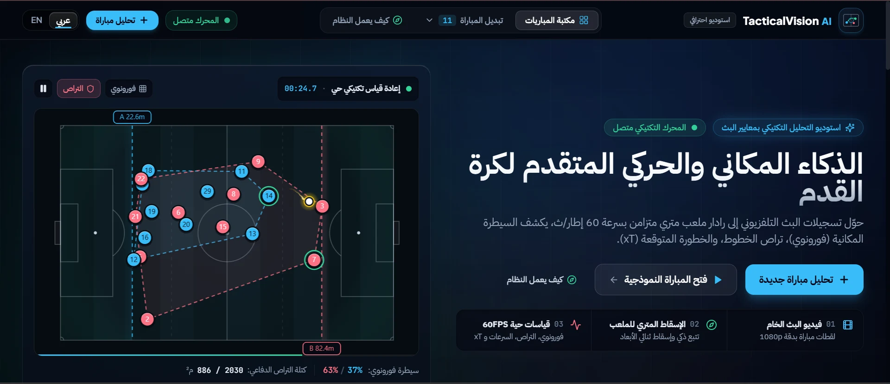
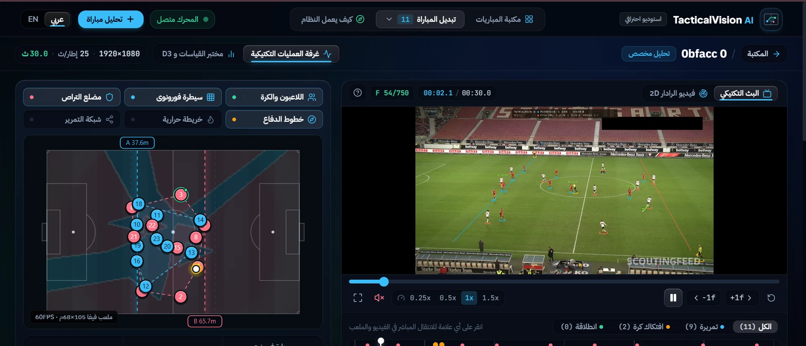
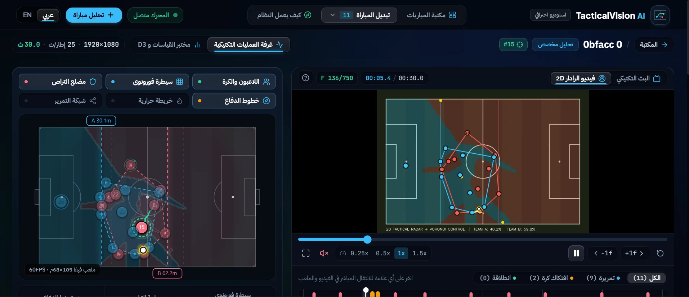
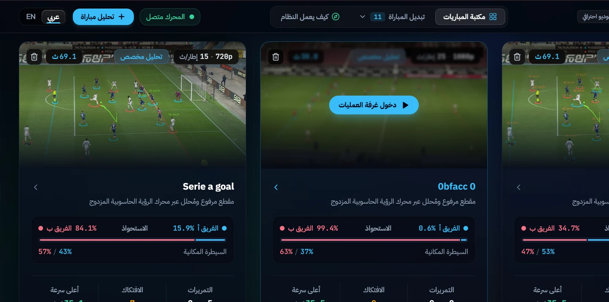
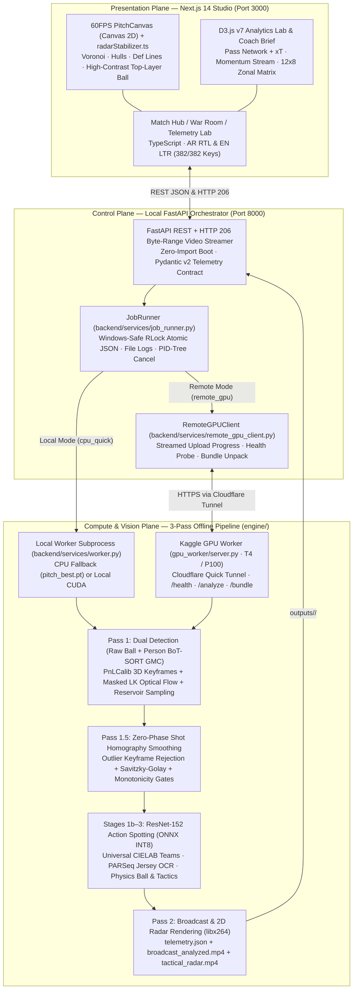

<div align="center">

# TacticalVision AI

**منصة هندسية متكاملة للذكاء التكتيكي في كرة القدم عبر كاميرا البث التلفزيوني الأحادية — معايرة ملعب ثلاثية الأبعاد (`PnLCalib 3D`)، تتبع هجين (`BoT-SORT + GMC`)، واستوديو تحليلات تفاعلي `60FPS` ثنائي اللغة (`AR RTL` / `EN LTR`).**

[](https://www.python.org/)
[](https://pytorch.org/)
[](https://onnxruntime.ai/)
[](https://fastapi.tiangolo.com/)
[](https://nextjs.org/)
[](https://www.typescriptlang.org/)
[](engine/pnlcalib_calibrator.py)
[](engine/detector.py)
[](docs/kaggle_gpu_worker.ipynb)
[](tests/)
[](frontend/src/lib/i18n.ts)

---

### جدول المحتويات السريع

[نبذة عن المنصة](#2-نبذة-عن-المشروع-والمنصة) · [المعمارية الهجينة](#3-المعمارية-الهندسية-وتوبولوجيا-التشغيل-الهجين) · [منظومة النماذج](#4-منظومة-النماذج-الذكية-التدريب-وإدارة-الأوزان) · [خط الأنابيب التكتيكي](#5-الابتكارات-الهندسية-وخط-أنابيب-المعالجة-التكتيكية) · [الاستوديو ومختبر D3](#6-قدرات-الاستوديو-التفاعلي-ومختبر-التحليل) · [واجهات البرمجة والبيانات](#7-عقود-البيانات-وواجهات-البرمجة) · [التحقق والقيود](#8-نتائج-التحقق-الهندسي-ونطاق-النظام) · [التشغيل والإعداد](#9-هيكل-المستودع-ودليل-التشغيل-والإعداد) · [المراجع والمؤلف](#10-المراجع-العلمية-التراخيص-والمؤلف)

</div>

---

### العرض البصري المباشر (`Visual Showcase`)

> لقطات حقيقية من استوديو **TacticalVision AI** (واجهة `AR RTL` / `EN LTR`) أثناء تحليل مباريات فعلية بمحرك **`PnLCalib 3D` + `Universal CIELAB` + `Pass 1.5 Savitzky-Golay`** على `Kaggle GPU`:

<div align="center">


<sub><b>الواجهة الرئيسية والرادار التفاعلي الحي (`60FPS Match Hub`)</b> — عرض تكتيكي مباشر باللغة العربية (`RTL`) مع مضلعات التراص (`Compactness Hulls`)، خطوط الدفاع، سيطرة `Voronoi`، والكرة المتوهجة في الطبقة العليا.</sub>

</div>

| غرفة العمليات التكتيكية — البث المحلَّل والرادار المتزامن (`War Room Broadcast`) | مطابقة الرادار المزدوج ومفتّش اللاعب (`Dual 2D Radar & Player Spotlight`) |
| :---: | :---: |
|  |  |
| <sub>مزامنة إطار بإطار بين فيديو البث (`1080p · 25 FPS`) ورادار `PitchCanvas` التفاعلي مع `6` طبقات تكتيكية وشريط الأحداث.</sub> | <sub>تطابق `1:1` بين `tactical_radar.mp4` (`PnLCalib 3D + Pass 1.5`) والرادار التفاعلي مع تفعيل مفتّش اللاعب `#15` ومساره.</sub> |

<div align="center">


<sub><b>مكتبة المباريات وبطاقات التحليل المتعدد (`Match Library & KPI Suite`)</b> — استعراض المباريات المحلَّلة (`Serie a goal`, `0bfacc_0`) مع مؤشرات الاستحواذ، السيطرة المكانية، التمريرات، والانتقال الفوري لغرفة العمليات.</sub>

</div>

---

<div dir="rtl">

## 2. نبذة عن المشروع والمنصة

**TacticalVision AI** هي منصة هندسية متكاملة لتحليل مباريات كرة القدم بالرؤية الحاسوبية، مصممة لتحويل **فيديو البث التلفزيوني القياسي أحادي الكاميرا** (`Single-Camera Broadcast Footage`) إلى بيانات مترية معايرة على ملعب `FIFA` القياسي (`105m × 68m`) وتقديمها داخل استوديو ويب تحليلي تفاعلي يعمل عند `60FPS`.

### الفجوة الهندسية التي تعالجها المنصة
تعتمد أنظمة التتبع الاحترافية داخل الملاعب على مصفوفات كاميرات ثابتة متعددة الزوايا وتجهيزات عتادية باهظة التكلفة. تسد **TacticalVision AI** هذه الفجوة عبر منظومة برمجية عامة ومستقلة عن هوية المباراة (`Match-Agnostic`) تعمل على أي بث تلفزيوني (دوريات مختلفة، إضاءة نهارية أو ليلية، أطقم سادة أو مخططة، لقطات قصيرة أو مباريات كاملة) مع دعم تفويض المعالجة الثقيلة تلقائياً إلى **Kaggle GPU Worker (`Tesla T4 / P100`)** دون الحاجة إلى بطاقة رسوميات محلية.

### المخرجات الفعلية لكل مباراة محلَّلة
ينتج خط الأنابيب لكل مقطع مرفوع حزمة متكاملة ومترابطة زمنياً:
- **`broadcast_analyzed.mp4`:** فيديو بث مشفّر بـ `H.264 (libx264)` يتضمن حلقات أرضية ثلاثية المنظور حسب الفريق، عزل الحكام باللون الأصفر دون نصوص، أرقام القمصان الموثَّقة (`#jn`)، خطوط الدفاع الافتراضية المُسقطة عكسياً عبر `H⁻¹` على العشب، مسار الكرة، وشريط `HUD` حي.
- **`tactical_radar.mp4`:** فيديو رادار تكتيكي `2D` معاير مترياً يعرض خرائط السيطرة المكانية (`Voronoi`)، مضلعات التراص (`Convex Hull`)، خطوط الدفاع، اللاعبين والحكام، ومسار الكرة المحكوم بالفيزياء.
- **`telemetry.json`:** عقد بيانات موحّد ومُتحقَّق منه عبر `Pydantic v2` يغذي جميع طبقات الاستوديو وتصديرات `CSV` / `JSON`.
- **غرفة العمليات التفاعلية (`60FPS War Room`) ومختبر `D3.js`:** مزامنة إطار بإطار مع رادار `Canvas 2D`، شبكات التمرير مع `Expected Threat (xT)`، خرائط الحرارة والزخم، وموجز تكتيكي آلي للمدرب (`Bilingual Tactical Coach Brief`) باللغتين العربية (`RTL`) والإنجليزية (`LTR`).

---

## 3. المعمارية الهندسية وتوبولوجيا التشغيل الهجين

تفصل المنصة بين **طبقة العرض (`Presentation Plane`)** و**طبقة التحكم والتنسيق (`Control Plane`)** و**طبقة الرؤية والحوسبة (`Compute & Vision Plane`)** لمنع تجميد خادم الـ API بسبب استيراد `PyTorch` أو `Ultralytics`، ولإتاحة التبديل السلس بين التشغيل المحلي (`Local CPU/CUDA`) والتشغيل السحابي البعيد (`Kaggle GPU Worker` عبر `Cloudflare Tunnel`).

</div>



<div dir="rtl">

---

## 4. منظومة النماذج الذكية، التدريب، وإدارة الأوزان

تعتمد المنصة على **5 ركائز تعلم عميق ورؤية حاسوبية** متكاملة وموثّقة بالكامل داخل [`artifacts/models_meta/models_registry.json`](artifacts/models_meta/models_registry.json) و[`docs/MODELS.md`](docs/MODELS.md):

| المكوّن | المعمارية (`Architecture`) | المهمة (`Task`) | البيانات وسلسلة التدريب (`Dataset / Training Lineage`) | الأوزان والتزويد (`Weights / Provisioning`) | بيئة التنفيذ (`CUDA` vs `CPU Fallback`) |
| :--- | :--- | :--- | :--- | :--- | :--- |
| **1. Entity Detection & Tracking** | Fine-tuned `YOLOv11m` (`1280px`) + `BoT-SORT (sparseOptFlow GMC)` | رصد `ball`, `goalkeeper`, `player`, `referee` وفصل تتبع الأشخاص عن الكرة الخام | مدرَّب على بيانات كرة قدم مخصّصة (`612` train / `38` val / `13` test؛ `14,583` صندوقاً) بعتبات F1 معايرة (`89.76% mAP@50` إجمالي، `99.43%` للاعبين، `95.45%` دقة للكرة) | `players_best.pt` (`38.7 MB`) عبر `MODELS_DIR` أو Kaggle Dataset | **CUDA:** `1280px` + `BoT-SORT (lap)`<br>**CPU:** `640px` + `PlayerByteTracker` |
| **2. 3D Pitch Calibration** | **Official `PnLCalib 3D`** (`Dual HRNetV2-w48` + `FramebyFrameCalib` PnL) + Masked LK Optical Flow | كشف `57` نقطة دلالية + `23` خطاً ثلاثي الأبعاد (بما فيها القوائم `Z = -2.44m`) وتقدير `(K, R, t)` وحساب `H_img_to_fifa` | أوزان `PnLCalib` الرسمية المدرّبة على `SoccerNet-Calibration`؛ والبديل `pitch_best.pt` (`YOLOv11m-pose`, `32` نقطة، `92.55% Pose mAP@50`) | `SV_kp` (`253 MB`) و `SV_lines` (`253 MB`) تُحمّل تلقائياً من GitHub Releases وتُخزّن في `/kaggle/working/pnlcalib_weights`؛ و`pitch_best.pt` (`41.3 MB`) في `MODELS_DIR` | **CUDA:** `pnlcalib_3d` (keyframes + flow)<br>**CPU:** `yolo_pitch_fallback` (`pitch_best.pt` + Law 1–4 + flow) |
| **3. Universal Team Affiliation** | **Match-Agnostic `CIELAB` 15-D + 2-Stage Outlier-Trimmed `KMeans(k=2)`** (+ `HSV` Fusion عند `ΔE < 16`) | فصل الفريقين دون تدريب مسبق، عزل الحكام، إسناد الحراس حسب المرمى الدفاعي، واستخراج `Hex` القمصان | خوارزمية غير خاضعة للإشراف (`Unsupervised`) مستقلة عن المباراة؛ أخذ عينات `Algorithm R Reservoir` عبر `0% → 100%` من الفيديو مع بوابة جودة اللاعب التكتيكي | لا تتطلب أوزاناً خارجية (تشغيل حتمي فوري على `CPU` و `GPU`) | متطابقة الدقة على **`CUDA`** و **`CPU`** (`ΔE_Lab = 38.5–57.9` عبر المباريات) |
| **4. Broadcast Action Spotting** | `ResNet-152 (TF2 ONNX)` + `PCA-512` + `Dilated ResTCN + 2L Bi-GRU + 4H Self-Attention` (`2.94M` params) | رصد `17` حدث بث تلفزيوني (`Goal`, `Shots`, `Corner`, `Cards`, ...) عند `2 FPS` مع `Cross-Class NMS` و`Corroborated Goal Rescue` | مستخرج ميزات متوافق مع معيار `SoccerNet-v2` (معالجة `BGR` + طرح متوسطات `Caffe [103.939, 116.779, 123.68]`)؛ رأس زمني حقّق `62.63% Loose a-mAP` و`47.95% Tight a-mAP` | `resnet152_tf2_backbone.onnx`, `soccernet_pca512_tf2_weights.npz`, `action_spotting_v1_int8.onnx` (`9.1 MB`) / `.pt` | **CUDA / CPU:** `ONNX Runtime` (`INT8` على CPU بزمن `21.14 ms/window`، و`FP32/CUDA` عند التوفر) |
| **5. Jersey Number Recognition (`OCR`)** | `MobileNetV3-Large-100` Legibility Gate (`4.20M` params) + `PARSeq` + Tracklet Voting | تصفية لقطات القمصان الواضحة (`Crop F1 = 90.47%`) وقراءة وتصويت رقم القميص الموثق (`1..99`) مع دعم التعديل اليدوي للمدرب | بوابة الوضوح مدرّبة على لقطات جذع اللاعبين (`Tracklet F1 = 85.97%`, `99.53% recall`) + نموذج `PARSeq` مسبق التدريب (مع تراجع `RapidOCR` عند غياب الإنترنت) | `jersey_legibility_v1_int8.onnx` (`16.0 MB`) / `.pt` + أوزان `PARSeq` عبر `torch.hub` | **CUDA:** `PARSeq CUDA` + Gate<br>**CPU:** `INT8 ONNX` (`11.16 ms`) + `RapidOCR` fallback |

### سياسة البيانات، التدريب، وفصل الأوزان الثنائية (`Weight Separation`)
- **فصل الأوزان عن Git:** جميع ملفات الأوزان الثقيلة (`*.pt`, `*.pth`, `*.onnx`, `*.npz`, `*.npy`) والفيديوهات الخام والمخرجة (`*.mp4`) مستبعدة تماماً عبر [`.gitignore`](.gitignore) للحفاظ على مستودع نظيف وسريع الاستنساخ.
- **التزويد التلقائي على Kaggle GPU:** تُربط الأوزان الثمانية الأساسية كـ `Kaggle Dataset` للقراءة فقط (`MODELS_DIR` دون نسخ)، بينما يقوم [`docs/kaggle_gpu_worker.ipynb`](docs/kaggle_gpu_worker.ipynb) تلقائياً باستنساخ `mguti97/PnLCalib` وتحميل أوزان `SV_kp` و`SV_lines` الرسمية من `GitHub Releases` وتخزينها مؤقتاً في `/kaggle/working/pnlcalib_weights` مع التحقق المباشر عبر `GET /health`.
- **تحرير الذاكرة المتسلسل (`Sequential Stage Memory Release`):** يُفرّغ [`engine/pipeline.py`](engine/pipeline.py) نماذج الكشف والمعايرة (`YOLO` و`PnLCalib`) من الـ `RAM/VRAM` فور انتهاء `Pass 1` وقبل تحميل `ResNet-152` ثم `PARSeq OCR` لمنع أخطاء نفاد الذاكرة (`OOM`) على الفيديوهات الطويلة.

---

## 5. الابتكارات الهندسية وخط أنابيب المعالجة التكتيكية

### 1) `Pass 1.5` — تنعيم الهوموغرافي بلا إزاحة طورية (`Zero-Phase Shot-Level Homography Smoothing`)
تُنفَّذ مرحلة ما بعد المعالجة في [`smooth_shot_homographies`](engine/homography.py) قبل إسقاط الإحداثيات النهائية للاعبين والكرة وقبل تصيير `tactical_radar.mp4`:
- **تقسيم اللقطات المتصلة:** فصل تسلسل المصفوفات `(H_t, hv_t, is_scene_cut_t)` عند القطوع المشهدية الحقيقية (مقاسة بفرق مدرج `HSV L1 > 0.45` مع `MAD > 28.0`) أو فترات انقطاع المعايرة.
- **رفض الإطارات المفتاحية الشاذة (`Outlier Keyframe Rejection`):** داخل كل لقطة متصلة، يُقاس مركز الملعب المُسقط `(cx_t, cy_t)` والمقياس المحلي `∂X/∂u`؛ وأي قفزة معزولة (`1–3` إطارات) تنحرف `> 6.0m` عن الوسيط المتحرك (`±7` إطارات) أو `> 45%` في المقياس تُستبدل باستيفاء خطي نظيف بين أقرب إطارين سليمين.
- **تنعيم `Zero-Phase Savitzky-Golay`:** تطبيق `scipy.signal.savgol_filter` (نافذة فردية متكيفة `~0.6s`, `polyorder=2`) على المصفوفات المطبّعة `H_t / H_t[2,2]`.
- **البوابات الهندسية الصارمة:** التحقق من قانون الرتابة الاتجاهية للبث (`∂X/∂u > 0`, `∂Y/∂v > 0`, `det(J) > 0`)، اتساق جانب منطقة الجزاء (`Law 2`)، وبوابة بقاء اللاعبين داخل الملعب (`Player In-Bounds Gate`). في اللقطات القريبة الحقيقية أو الاحتفالات عديمة المعالم الهندسية، يضبط المحرك `hv = false` بصدق بدلاً من تجميد إسقاط خاطئ.

### 2) تتبع الكرة المحكوم بالفيزياء ونزاهة المسار (`Physics-Gated Ball Tracking & Trail Integrity`)
- **فصل الكرة عن فلتر `BoT-SORT`:** في [`engine/detector.py`](engine/detector.py)، يُنفَّذ `players_model.predict()` مرة واحدة للإبقاء على **100% من كشوفات الكرة الخام** (`ball_conf`), بينما تُمرَّر صناديق الأشخاص فقط إلى `BOTSORT(gmc_method="sparseOptFlow")`.
- **إلغاء التثبيت القسري على الزوايا (`No Corner Clamping`):** في [`engine/pipeline.py`](engine/pipeline.py) و[`filter_and_interpolate_ball_pitch`](engine/tactics.py)، تُستبعد أي كرة مسقطة خارج `[-1.5..106.5, -1.5..69.5]` أو خلف الأفق (`|w| <= 0.05`) وتُحوَّل إلى `None` بدلاً من قصها إلى `(0, 0)` أو `(105, 68)`.
- **فلترة السرعة والاستيفاء:** رفض قفزات `1–2` إطار غير المتماسكة التي تتجاوز سقف سرعة كرة القدم الفيزيائي (`<= 38.0 m/s` أو `> 10.0m` في إطار واحد)، واستيفاء الفجوات القصيرة (`1..8` إطارات، `<= 0.40s` بسرعة `<= 35.0 m/s`) مع تنعيم خفيف من `5` نقاط (`[0.12, 0.22, 0.32, 0.22, 0.12]`).
- **قاعدة قطع المسار الصارمة (`Discontinuous Trail Break`):** في كلٍّ من [`engine/renderer.py`](engine/renderer.py) و[`drawPlayers.ts`](frontend/src/components/warroom/canvas/drawPlayers.ts)، يُمنع رياضياً رسم خط يصل بين نقطتي كرة إذا تجاوزت الفجوة الزمنية `0.25s` أو المسافة المترية `8.0m`.

### 3) تصنيف الفرق العام (`Universal Match-Agnostic Team Affiliation`)
في [`engine/team_classifier.py`](engine/team_classifier.py):
- **عينات طبقية شاملة (`Algorithm R Reservoir Sampling`):** جمع حتى `720` عينة صدرية موزعة باحتمالية متساوية على طول الفيديو (`0% → 100%`) لضمان عدم تشبّع التجميع بالثواني الأولى.
- **بوابة الجودة التكتيكية (`is_valid_tactical_box`):** قبول اللاعبين التكتيكيين فقط (`0.04 <= h/H <= 0.22`، نسبة أبعاد `0.18..1.25`، بعيداً عن شريط البث العلوي والحدود، غير متداخلين `IoU < 0.15`).
- **عزل الجذع + وصف `CIELAB` (15 بُعداً):** قص شريط الصدر الداخلي (`y: 16%..48%, x: 26%..74%`)، معايرة تكيفية لعشب الملعب، قناع بشرة ذكي يحفظ القمصان الكريمية والبرتقالية والخضراء، ثم **تجميع `KMeans(k=2)` على مرحلتين بحذف أبعد `15%` من الشواذ**، وتصويت موزون بالهامش `|d0 - d1| / (d0 + d1)` لكل مسار لاعب مع استخراج `team_a_kit_hex` و`team_b_kit_hex`.

### 4) محرك التحليلات التكتيكية والكينماتيكية (`Tactical & Kinematic Analytics Engine`)
في [`engine/tactics.py`](engine/tactics.py):
- **سلامة الاستحواذ والتمريرات:** آلة حالة غير متماثلة لتمييز التمريرات عن لمسات المدافعين العابرة (`min_turnover_frames = 5`), مدعومة بتراجع مسافة بكسلية (`<= 0.95 * box_h`) عند الفجوات المعايرية العابرة وعتبة تهيئة `>= 5` لمسات في `HUD`.
- **التهديد المتوقع (`Expected Threat — xT`):** مصفوفة `Karun Singh (12 × 8)` محصنة ضد `NaN/Inf` وحدود المرمى (`lookup_xt`).
- **السيطرة المكانية والتراص:** حساب `Voronoi` على شبكة `105 × 68` (الأثلاث الدفاعي والوسطي والهجومي)، مساحة المحدّب (`Convex Hull m²`)، وعمق خط الدفاع الأخير (`def_x`).
- **معايرة الانطلاقات السريعة (`High-Speed Sprints`):** سرعة متدحرجة ملساء `>= 6.2 m/s` (`22.3 km/h`) مستمرة لمدة `>= 0.55s` مع تحمل ومضات التتبع (`1–2` إطار) وفترة تهدئة `4.0s` ورفض القفزات غير البشرية (`> 11.5 m/s`).

---

## 6. قدرات الاستوديو التفاعلي ومختبر التحليل

توفر واجهة `Next.js 14` (`frontend/src/`) تجربة تحليلية متزامنة بالكامل في ثلاث مساحات عمل:
1. **مركز المباريات (`Match Hub — /`):** عرض حي متحرك عند `60FPS` لأفضل نافذة تكتيكية (`HeroPitchVisual`)، بطاقات المباريات مع صور مصغرة مخبّأة، البحث والفرز، ونافذة رفع متكاملة (`UploadModal`) تدعم التحليل الكامل دون اقتطاع (`Full Video`) والاتصال المباشر بـ `Kaggle Remote GPU` مع شريط رفع وتقدم حي.
2. **غرفة العمليات التكتيكية (`Tactical War Room — /match/[id]`):**
   - مشغل فيديو `H.264` متزامن إطاراً بإطار مع رادار `PitchCanvas` التفاعلي (`60FPS` عبر [`radarStabilizer.ts`](frontend/src/lib/radarStabilizer.ts)).
   - **كرة عالية الوضوح في الطبقة العليا (`Highest Z-Index`):** تُرسم الكرة ومسارها الذهبي المتدرج فوق جميع الطبقات واللاعبين (`core r=5.5px` أبيض، حلقة `#0F172A`، وهج `#FACC15`).
   - **توقف صادق ونظيف عند `hv = false`:** في اللقطات القريبة والاحتفالات يُرسم الملعب الفارغ فقط مع شارة توقف مركزية دون أي نقاط أو طبقات متبقية.
   - `6` طبقات تكتيكية قابلة للتبديل (`Voronoi`, `Convex Hulls`, `Def Lines`, `Heatmap`, `Pass Network`, `Players`)، مفتّش اللاعب المدمج (`PlayerSpotlight`) مع إمكانية تعديل رقم القميص يدوياً (`Coach Override`)، وشريط أحداث تفاعلي يدعم **إعادة اللقطة (`Replay -3s`)** وأحداث `Model 3 Action Spotting`.
3. **مختبر التحليلات (`D3.js Analytics Lab`) والموجز التكتيكي (`CoachBrief`):**
   - شبكة التمريرات التفاعلية (`D3PassNetworkPitch`)، تدفق الزخم والسيطرة (`D3MomentumStream`)، مصفوفة السيطرة المناطقية `12 × 8` (`D3ZonalControlMatrix`)، رادار اللاعب (`D3PlayerRadar`)، وجدول اللاعبين القابل للتصدير (`CSV` / `JSON`).
   - محرك صياغة تكتيكية آلي ([`coachBriefEngine.ts`](frontend/src/lib/coachBriefEngine.ts)) متوافق تماماً مع اللغتين العربية (`RTL`) والإنجليزية (`LTR`) بتطابق **`382 / 382` مفتاح ترجمة** في [`i18n.ts`](frontend/src/lib/i18n.ts) وحماية اتجاه الأرقام عبر `<BidiNum>`.

---

## 7. عقود البيانات وواجهات البرمجة

### 1) واجهات خادم التنسيق المحلي (`FastAPI — backend/`, Port `8000`)

| الطريقة | المسار (`Endpoint`) | الوظيفة والتفاصيل التقنية |
| :--- | :--- | :--- |
| `GET` | `/api/health` | فحص جاهزية الخادم (`{"status": "ok", "service": "TacticalVision AI"}`). |
| `GET` | `/api/matches` | سرد جميع المباريات المتاحة في `outputs/` (العينات والمباريات المرفوعة). |
| `GET` | `/api/matches/{match_id}` | إرجاع بطاقة الملخص (`MatchCard`) لمباراة محددة. |
| `GET` | `/api/matches/{match_id}/telemetry` | بث ملف `telemetry.json` مباشرة عبر `FileResponse` دون إعادة تسلسل مكلفة. |
| `GET` | `/api/matches/{match_id}/video/{video_type}` | بث `broadcast` أو `radar` مع دعم **`HTTP 206 Partial Content`** للتقديم والترجيع الفوري. |
| `GET` | `/api/matches/{match_id}/thumbnail` | توليد وتخزين صورة مصغرة `640×360 JPEG` للبطاقة. |
| `GET` | `/api/matches/{match_id}/export` | تصدير بيانات اللاعبين أو الأحداث بصيغة `CSV` أو `JSON` (`?format=csv\|json&scope=players\|events`). |
| `POST` | `/api/gpu/ping` | التحقق من اتصال `Remote GPU Worker` وإرجاع جاهزية `CUDA` و`PnLCalib 3D`. |
| `POST` | `/api/matches/analyze` | رفع فيديو (`.mp4/.mov/.mkv`) وتشغيل التحليل (`cpu_quick` أو `remote_gpu`، `max_seconds=0` للفيديو الكامل، `enable_jersey_ocr`)؛ يرجع `202` + `job_id`. |
| `GET` | `/api/jobs/{job_id}` | متابعة التقدم الحي للمهمة (`status`, `progress_pct`, `stage_label`, `elapsed_s`, `match_id`). |
| `POST` | `/api/jobs/{job_id}/cancel` | إنهاء شجرة العمليات (`PID-Tree`) وتنظيف الملفات المؤقتة فوراً. |
| `DELETE` | `/api/matches/{match_id}` | حذف مباراة مرفوعة من المستخدم (محمي بـ `403` ضد حذف مباريات `match_0*` الأساسية). |
| `GET` | `/api/models/suite` | استعراض سجل النماذج الأربعة وحالة الأوزان ومعايير التقييم. |
| `GET` / `POST` | `/api/action-spotting/matches`, `/analyze`, `/results/{run_id}` | تشغيل واستعراض نتائج `Model 3 Action Spotting` على متجهات `SoccerNet (.npy/.npz)` لمباراة كاملة. |

### 2) واجهات عامل الـ GPU السحابي (`gpu_worker/server.py`, Port `8001`)

| الطريقة | المسار (`Endpoint`) | الوظيفة والاستجابة |
| :--- | :--- | :--- |
| `GET` | `/health` | يرجع `gpu_available`, `gpu_name`, `vram_gb`, `models_ready`, `missing_models`, بالإضافة إلى **`calibrator_backend`** (`"pnlcalib_3d"` أو `"yolo_pitch_fallback"`) و**`pnlcalib_ready`** (`true`/`false`). |
| `POST` | `/analyze` | استقبال الفيديو بحد أقصى `500 MB` وتشغيل خط الأنابيب الكامل غير المتزامن (`202` + `job_id`). |
| `GET` | `/jobs/{job_id}/status` | بث حالة المراحل (`detecting`, `classifying`, `computing`, `encoding`, `completed`), النسبة المئوية, وآخر أسطر السجل. |
| `GET` | `/jobs/{job_id}/bundle` | تنزيل حزمة `bundle.zip` (`telemetry.json` + الفيديوهين + المعاينة) وتنظيف مجلد العمل تلقائياً. |
| `POST` | `/jobs/{job_id}/cancel` | إيقاف المهمة وتنظيف ملفاتها المؤقتة فوراً. |

### 3) عقد بيانات التليميتري (`telemetry.json` Schema Contract)

</div>

```jsonc
{
  "match_info": {
    "source_video": "0bfacc_0.mp4",
    "resolution": [1920, 1080],
    "fps": 25.0,
    "pitch_dimensions_m": [105.0, 68.0],
    "team_colors": { "0": "#1EC8FF", "1": "#FF5555" },
    "team_a_kit_hex": "#A35F46",
    "team_b_kit_hex": "#F5F2E4"
  },
  "summary": {
    "total_frames": 750,
    "fps": 25.0,
    "duration_s": 30.0,
    "possession_pct": { "team_0": 54.0, "team_1": 46.0 },
    "pitch_control_pct": {
      "team_0": 38.2,
      "team_1": 61.8,
      "team_0_zonal": { "defensive_third": 73.5, "middle_third": 37.0, "attacking_third": 4.0 }
    },
    "passes": { "team_0": 6, "team_1": 9 },
    "turnovers": 2,
    "expected_threat_xt": { "team_0": 0.0205, "team_1": 0.0056 },
    "avg_convex_hull_area_m2": { "team_0": 710.6, "team_1": 1282.1 },
    "top_speed_kmh": 30.6
  },
  "frames": [
    {
      "f": 236,
      "t": 15.73,
      "hv": true,
      "players": [
        { "id": 18, "team": 1, "role": "p", "x": 82.4, "y": 46.1, "spd": 24.8, "jn": 23, "jv": true }
      ],
      "ball": [84.1, 45.3],
      "vor": [57.4, 42.6],
      "def_x": { "0": 77.2, "1": 94.8 }
    }
  ],
  "events": [
    { "type": "pass", "frame": 142, "time_s": 5.68, "team": 1, "from_id": 7, "to_id": 11, "distance_m": 16.4, "xt_delta": 0.0091, "is_progressive": true },
    { "type": "sprint", "frame": 361, "time_s": 14.44, "track_id": 18, "team": 1, "speed_kmh": 24.8 }
  ],
  "broadcast_events": [
    { "class_id": 2, "label": "Goal", "category": "scoring", "half": 1, "frame_idx": 40, "time_s": 21.33, "minute_str": "00:21", "confidence": 0.181 }
  ],
  "engine_diagnostics": {
    "calibrator_backend": "pnlcalib_3d",
    "homography": {
      "valid_frames": 384,
      "rejected_frames": 0,
      "flow_propagated_frames": 734,
      "stability_rate_pct": 100.0,
      "shots_smoothed": 1,
      "outliers_replaced": 36,
      "frames_smoothed": 750
    },
    "team_classifier": { "mode": "cielab_universal_primary", "delta_e_lab": 57.89, "stratified_samples_used": 720 },
    "ball_coverage_pct": 90.67,
    "jersey_recognition": { "gate_backend": "onnx_int8", "ocr_status": "parseq_cuda_active", "verified_players": 14 },
    "broadcast_spotting_backend": "onnx_int8"
  }
}
```

<div dir="rtl">

> ملاحظة: تدعم الواجهة تخصيص أرقام القمصان يدوياً للمدرب (`Coach Override`) محلياً لكل مباراة عبر [`frontend/src/lib/jerseyOverrides.ts`](frontend/src/lib/jerseyOverrides.ts) مع مزامنة فورية على الرادار وشبكة التمريرات وجدول اللاعبين.

---

## 8. نتائج التحقق الهندسي ونطاق النظام

### 1) مؤشرات التحقق الآلي والمعملي المُقاسة فعلياً

| محور التحقق | الأداة / السيناريو | النتيجة المُقاسة |
| :--- | :--- | :--- |
| **مجموعة الاختبارات الخلفية والمحرك** | `python -m pytest -v` (`6` ملفات اختبار) | **`45 / 45` اختباراً ناجحاً (`100%`)** — تغطي `PnLCalib 3D`، `Pass 1.5 Savitzky-Golay`، `Universal CIELAB`، فلتر الكرة، الانطلاقات، `Model 3`، `Model 4`، و`GPU Worker` |
| **فحص الأنواع وبناء الواجهة** | `npx tsc --noEmit` + `npm run build` (`Next.js 14.2.21`) | **`0` أخطاء** — بناء إنتاجي نظيف (`/` و`/match/[id]`) |
| **تطابق التوطين الثنائي (`i18n`)** | فحص آلي لملف [`frontend/src/lib/i18n.ts`](frontend/src/lib/i18n.ts) | **`382` مفتاحاً إنجليزياً = `382` مفتاحاً عربياً (`diff = 0`)** |
| **كرات الزوايا وقفزات الليزر (Bundesliga `0bfacc_0` — `PnLCalib 3D`)** | مقارنة `Before` vs `After` على `750` إطاراً (`25 FPS`) | كرات الزوايا: `14 → 0` · قفزات `> 10m`: `48 → 0` · أقصى قفزة إطار واحد: **`124.61m → 1.17m`** (تشغيل Kaggle GPU الحي) |
| **ثبات الهوموغرافي (`Pass 1.5 Savitzky-Golay`)** | `0bfacc_0` (`25 FPS`) و`match_01_counter` | اهتزاز `median_x`: `0.912 → 0.121 m/fr` (معالجة `36` إطاراً شاذاً في التشغيل الحي لـ `0bfacc_0`) |
| **استعادة كشف الكرة بفصل `BoT-SORT`** | مقارنة تغطية الكرة على `match_01` و`Serie a goal` | ارتفعت من `52.8% → 90.67%` (Bundesliga) ومن `13.98% → 36.55%` (Serie A) |
| **فصل الفرق عبر مباريات متنوعة (`CIELAB`)** | `4` مباريات حقيقية (`Bundesliga`, `Serie A`, `match_02`, `match_03`) | `ΔE_Lab = 38.5 – 57.89` · ثبات مسار الفريق: **`100.0%`** (دون وميض بين الإطارات) |

### 2) نطاق النظام والقيود الفيزيائية (`Scope & Physical Constraints`)
- **مجال الرؤية أحادي الكاميرا (`Single-Camera Visibility`):** ترصد المنصة وتُعاير اللاعبين الظاهرين ضمن كادر البث التلفزيوني فقط؛ اللاعبون خارج إطار الكاميرا لا يمكن استنتاج مواقعهم مقارنة بأنظمة تتبع الملاعب متعددة الكاميرات.
- **التوقف الصادق أثناء اللقطات القريبة (`hv = false`):** في لقطات الوجوه القريبة، الاحتفالات، مقاعد البدلاء، أو الإعادات المقرّبة التي تنعدم فيها معالم خطوط الملعب، يعلّق المحرك الإسقاط عمداً (`hv = false`) ويعرض ملعباً فارغاً نظيفاً في الاستوديو بدلاً من إنتاج إحداثيات مختلقة.
- **الفارق بين تشغيل `Kaggle GPU (PnLCalib 3D)` والتشغيل المحلي `CPU`:** يوفر تشغيل `CUDA GPU` دقة `PnLCalib 3D` (57 نقطة + 23 خطاً ثلاثي الأبعاد + `PARSeq CUDA` + `BoT-SORT` عند `1280px`)، بينما يستخدم التشغيل المحلي على `CPU` مسار `yolo_pitch_fallback` (`pitch_best.pt` المحصن بـ `Law 1–4` و`Optical Flow` و`Pass 1.5`) مع `INT8 ONNX` و`RapidOCR` للعمل دون بطاقة رسوميات.

---

## 9. هيكل المستودع ودليل التشغيل والإعداد

### هيكل المستودع (`Repository Structure`)

</div>

```text
TacticalVision-AI/
├── engine/                           # محرك الرؤية الحاسوبية والتحليلات التكتيكية
│   ├── config.py                     # إعدادات ملعب FIFA (105x68m)، مصفوفة xT (12x8)، وEngineConfig
│   ├── detector.py                   # كشف YOLOv11m مع الحفاظ على 100% من الكرة الخام + BoT-SORT للأشخاص فقط
│   ├── pnlcalib_calibrator.py        # تكامل PnLCalib 3D الرسمي (HRNetV2-w48 + PnL) مع التراجع السلس للـ CPU
│   ├── homography.py                 # بوابات الرتابة الهندسية (Law 1–4)، التدفق البصري المقنّع، وتنعيم Pass 1.5
│   ├── team_classifier.py            # مصنف CIELAB العام (Algorithm R + بوابة تكتيكية + 2-Stage KMeans + OOD Ref)
│   ├── tracker.py                    # PlayerByteTracker وKalmanBallTracker
│   ├── video_feature_extractor.py    # مستخرج ResNet-152 TF2 ONNX + PCA-512 (BGR Caffe contract)
│   ├── action_spotter.py             # نموذج رصد الأحداث الـ 17 + Cross-Class NMS + Corroborated Goal Rescue
│   ├── jersey_recognizer.py          # بوابة MobileNetV3 INT8 + PARSeq OCR وتصويت المسار
│   ├── tactics.py                    # فلتر الكرة الفيزيائي، الاستحواذ، التمريرات، Voronoi، Hulls، xT، والانطلاقات
│   ├── renderer.py                   # تصيير البث والرادار 2D (مع قاعدة قطع المسار) والترميز بـ libx264
│   └── pipeline.py                   # المنسق الرئيسي ثلاثي المراحل (Pass 1 → Pass 1.5 → Stages 1b–3 → Pass 2)
├── backend/                          # خادم التنسيق المحلي FastAPI (Port 8000)
│   ├── config.py                     # إعدادات Pydantic v2 (بادئة TV_)
│   ├── main.py                       # نقطة الدخول، CORS، وربط الموجهات الثمانية دون استيراد PyTorch
│   ├── models/schemas.py             # عقود البيانات الصارمة (Telemetry, MatchCard, JobStatus)
│   ├── routers/                      # matches, telemetry, video (HTTP 206), export, assets, upload, models_suite, action_spotting
│   └── services/                     # job_runner (Windows-safe RLock), remote_gpu_client, worker, match_service, video_streamer
├── gpu_worker/                       # خادم المعالجة السحابية المستقل لـ Kaggle / Colab (Port 8001)
│   └── server.py                     # نقاط /health (مع pnlcalib_ready) و/analyze و/status و/bundle و/cancel
├── frontend/                         # استوديو الويب التفاعلي Next.js 14 + TypeScript + D3.js v7 (Port 3000)
│   └── src/
│       ├── app/                      # Match Hub (/) وWar Room + Analytics Lab (/match/[id])
│       ├── components/               # PitchCanvas, drawPlayers, VideoPlayer, PlayerSpotlight, CoachBrief, UploadModal, d3/
│       └── lib/                      # api.ts, i18n.ts (382/382), radarStabilizer.ts, jerseyOverrides.ts, coachBriefEngine.ts, types.ts
├── docs/                             # التوثيق الفني، نوتبوك Kaggle، والأصول البصرية
│   ├── kaggle_gpu_worker.ipynb       # نوتبوك Kaggle الجاهز (تثبيت تلقائي لـ PnLCalib 3D + SV_kp/SV_lines + Cloudflare Tunnel)
│   ├── MODELS.md                     # بطاقات النماذج العلمية ومقاييس ONNX INT8 التفصيلية
│   └── assets/                       # 4 لقطات استوديو عالية الدقة بصيغة WebP (82–127 KB لكل صورة)
├── artifacts/models_meta/            # سجل النماذج، العتبات المعايرة، وتقارير المقاييس
├── outputs/match_0*/                 # عينات تليميتري جاهزة للاستعراض الفوري دون أوزان
└── tests/                            # 45 اختباراً آلياً شاملاً (pytest)
```

<div dir="rtl">

### متغيرات البيئة والإعدادات (`Configuration & Environment Variables`)

| المتغير | النطاق | القيمة الافتراضية | الوظيفة |
| :--- | :--- | :--- | :--- |
| `TV_FRONTEND_ORIGIN` | Backend (`.env`) | `http://localhost:3000` | مصدر `CORS` المسموح به لطلبات المتصفح. |
| `TV_REMOTE_GPU_WORKER_URL` / `REMOTE_GPU_URL` | Backend (`.env`) | `""` (معطّل) | رابط عامل `Kaggle GPU` الافتراضي عند تفعيل وضع `remote_gpu`. |
| `TV_CPU_QUICK_MAX_SECONDS` | Backend (`.env`) | `0.0` (`Full Video`) | الحد الافتراضي للمدة بالثواني (`0.0` = تحليل الفيديو كاملاً دون اقتطاع). |
| `TV_CPU_QUICK_MAX_SECONDS_LIMIT` | Backend (`.env`) | `600.0` | السقف الأقصى للمدة بالثواني في وضع `cpu_quick`. |
| `TV_SUBPROCESS_TIMEOUT_S` | Backend (`.env`) | `3600` | مهلة تشغيل عملية التحليل الفرعية بالثواني. |
| `MODELS_DIR` | GPU Worker / Local | `./models` | مسار مجلد الأوزان الأساسية (يدعم `/kaggle/input/...` للقراءة فقط). |
| `PNLCALIB_REPO_DIR` | GPU Worker / Engine | `/kaggle/working/PnLCalib` | مسار مستودع `mguti97/PnLCalib` المستنسخ لتشغيل `PnLCalib 3D`. |
| `PNLCALIB_WEIGHTS_DIR` | GPU Worker / Engine | `/kaggle/working/pnlcalib_weights` | مسار أوزان `SV_kp` و`SV_lines` المخبّأة. |
| `GPU_WORK_DIR` | GPU Worker | `tempdir/tacticalvision_gpu_jobs` | مجلد العمل المؤقت للرفع وحزم `bundle.zip`. |
| `NEXT_PUBLIC_API_URL` | Frontend (`.env.local`) | `http://localhost:8000` | عنوان خادم `FastAPI` المستخدم في عميل الواجهة (`api.ts`). |

### دليل التشغيل السريع (`Quick Start`)

#### 1) تشغيل الخادم المحلي (`FastAPI`) والواجهة (`Next.js`)

</div>

```bash
# 1. استنساخ المستودع وتجهيز البيئة الافتراضية
git clone https://github.com/Mazenalodini/TacticalVision-AI.git
cd TacticalVision-AI
python -m venv .venv
# Windows PowerShell: .\.venv\Scripts\Activate.ps1
# Linux / macOS:      source .venv/bin/activate

# 2. تثبيت اعتماديات الخادم وتشغيل FastAPI (Port 8000)
pip install -r backend/requirements.txt
# لتفعيل التحليل المحلي على CPU أضف أيضاً:
# pip install torch torchvision ultralytics opencv-python-headless scikit-learn scipy imageio-ffmpeg onnxruntime rapidocr-onnxruntime
uvicorn backend.main:app --host 0.0.0.0 --port 8000
```

```bash
# 3. في نافذة طرفية ثانية — تثبيت وتشغيل الواجهة (Port 3000)
cd frontend
npm install
npm run build
npm run start
```

<div dir="rtl">

> افتح **`http://localhost:3000`** لاستعراض العينات المتتبَّعة (`match_01_counter`, `match_02_buildup`, `match_03_press`) مباشرة، أو ارفع أي مقطع جديد عبر **Analyze Match**.

#### 2) تشغيل عامل المعالجة السحابي `Kaggle GPU Worker` (`PnLCalib 3D` — 3 خطوات)

1. ارفع الملف [`docs/kaggle_gpu_worker.ipynb`](docs/kaggle_gpu_worker.ipynb) إلى **Kaggle** مع تفعيل **Accelerator: `GPU T4 x2` أو `P100`**، تفعيل **Internet: `ON`**، وإرفاق Dataset الأوزان الأساسية (`tacticalvision-models`).
2. شغّل **الخلية 1 → الخلية 2 → الخلية 3** بالترتيب؛ ستقوم الخلية 1 تلقائياً بسحب فرع `main` عبر `FETCH_HEAD`، واستنساخ `mguti97/PnLCalib`، وتحميل أوزان `SV_kp` و`SV_lines` الرسمية وتخزينها، وستطبع الخلية 3 جاهزية `/health` مؤكِّدةً:
   ```json
   { "calibrator_backend": "pnlcalib_3d", "pnlcalib_ready": true }
   ```
3. انسخ رابط `https://xxxx.trycloudflare.com` المطبوع في الخلية 3 والصقه داخل **Analyze Match → Remote GPU (Kaggle / Colab)** في الاستوديو المحلي ثم اضغط **Test Connection** وابدأ التحليل.

#### 3) أوامر التحقق والاختبار الآلي

</div>

```bash
# تشغيل مجموعة الاختبارات الكاملة (45 اختباراً)
python -m pytest -v

# فحص أنواع TypeScript وبناء Next.js الإنتاجي
cd frontend
npx tsc --noEmit
npm run build
```

<div dir="rtl">

---

## 10. المراجع العلمية، التراخيص، والمؤلف

### المراجع والأعمال العلمية المعتمدة (`Scientific References & Credits`)
- **PnLCalib (3D Broadcast Sports Field Calibration):** Marc Gutiérrez-Pérez & Antonio Agudo, *"PnLCalib: Sports Field Registration via Points and Lines Optimization"*, Computer Vision and Image Understanding (CVIU), 2026 ([`mguti97/PnLCalib`](https://github.com/mguti97/PnLCalib)).
- **SoccerNet Benchmarks (Action Spotting, Tracking, Calibration & Jersey Recognition):** Giancola et al. / Cioppa et al., *SoccerNet-v2 & Game State Reconstruction* ([`SoccerNet`](https://www.soccer-net.org/)).
- **BoT-SORT:** Nir Aharon, Roy Orfaig, Ben-Zion Bobrovsky, *"BoT-SORT: Robust Associations Multi-Pedestrian Tracking"* (2022).
- **PARSeq OCR:** Darwin Bautista & Rowel Atienza, *"Scene Text Recognition with Permuted Autoregressive Sequence Models"*, ECCV 2022.
- **Ultralytics YOLOv11:** Ultralytics Object Detection & Pose Estimation Framework ([`ultralytics/ultralytics`](https://github.com/ultralytics/ultralytics)).
- **Expected Threat (`xT`):** Karun Singh, *"Introducing Expected Threat (xT)"* (`12 × 8` pitch threat grid).

### المؤلف والتطوير (`Author`)

**المهندس مازن محمد عبد العزيز العديني — Eng. Mazen Alodini**  
GitHub: [https://github.com/Mazenalodini](https://github.com/Mazenalodini) · Repository: [TacticalVision-AI](https://github.com/Mazenalodini/TacticalVision-AI)

> **التراخيص:** يتكامل المشروع مع مكونات مفتوحة المصدر تخضع كلٌّ منها لترخيصها الأصلي (`MIT` / `Apache-2.0` / `AGPL-3.0` لـ Ultralytics).

</div>
