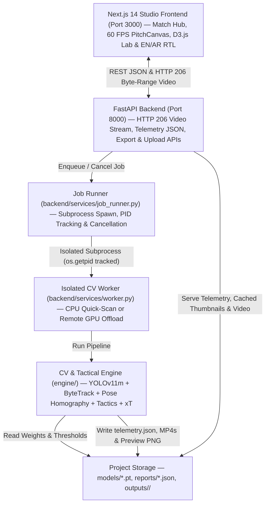

# TacticalVision AI

**End-to-End Football Broadcast Computer Vision, Spatial Homography & Bilingual (EN/AR) Tactical Intelligence Studio**

[](https://www.python.org/)
[](https://docs.ultralytics.com/)
[](https://opencv.org/)
[](https://fastapi.tiangolo.com/)
[](https://nextjs.org/)
[](https://www.typescriptlang.org/)
[](https://d3js.org/)
[](https://www.framer.com/motion/)
[](https://tailwindcss.com/)
[](#)

---

## Executive Overview

**TacticalVision AI** transforms raw single-camera football broadcast footage into calibrated metric coordinates (`105 × 68 m` FIFA pitch plane) and an interactive broadcast studio for coaches, performance analysts, and sports data engineers. A dual-model **YOLOv11** computer vision pipeline (`engine/`) detects players, goalkeepers, referees, the ball, and 32 pitch landmarks, stabilizes player identities with **ByteTrack**, projects positions via RANSAC planar homography, clusters teams automatically (`SigLIP + UMAP + KMeans` with an offline `CIE LAB + PCA` fallback), and computes frame-by-frame tactical and kinematic telemetry.

On top of the CV engine sits a production **FastAPI** backend (`backend/`) and a **Next.js 14** studio frontend (`frontend/`). The backend isolates heavy PyTorch inference inside dedicated worker subprocesses so the API server boots instantaneously, streams annotated H.264 video with HTTP `206 Partial Content` byte-range seeking, manages real PID-tracked job cancellation, and supports hybrid **Local CPU Quick-Scan** or **Remote GPU Worker** offloading. The frontend delivers a synchronized broadcast player, a 60 FPS HTML5 2D tactical pitch canvas, interactive **D3.js v7** visualizations, Recharts match timelines, and full **English (LTR) / Arabic (RTL)** localization.

<details>
<summary>📖 نظرة عامة على المشروع بالعربية (Arabic Overview)</summary>

**TacticalVision AI** هي منصة متكاملة لتحليل مباريات كرة القدم بالذكاء الاصطناعي والرؤية الحاسوبية، مصممة لتحويل لقطات البث التلفزيوني الأحادية إلى إحداثيات مترية دقيقة على ملعب فيفا القياسي (`105 × 68 متر`) مع استوديو تحليلي تفاعلي ثنائي اللغة (**العربية RTL / الإنجليزية LTR**).

يعتمد محرك الرؤية الحاسوبية (`engine/`) على نموذجي **YOLOv11** متكاملين: نموذج لاكتشاف اللاعبين وحراس المرمى والحكام والكرة وتتبعهم عبر الزمن باستخدام **ByteTrack**، ونموذج **YOLOv11m-pose** لاستخراج 32 نقطة مرجعية للملعب وحساب مصفوفة التحويل الهندسي (**RANSAC Homography**) مع تنعيم زمني (**EMA**). بعد إسقاط المواقع على الملعب، يقوم النظام بتصنيف الفرق آلياً، وحساب السيطرة المكانية (**Voronoi**)، ومساحة الانتشار (**Convex Hull**)، وخطوط الدفاع الافتراضية، والسرعات الفيزيائية والانطلاقات السريعة، ومؤشر التهديد المتوقع (**xT 12×8**)، واستخراج التمريرات والالتحامات تلقائياً.

على مستوى المنصة، يوفر خادم **FastAPI** (`backend/`) بثاً فورياً للفيديو عبر بروتوكول **HTTP 206**، وعزل عمليات المعالجة الثقيلة في عمليات فرعية مستقلة مع دعم الإلغاء الفعلي للوظائف عبر معرف العملية (`PID`)، والتبديل بين الفحص السريع على المعالج المحلي أو تفويض المعالجة إلى خادم GPU بعيد، بالإضافة إلى تصدير البيانات بصيغتي `CSV` و `JSON`. وتقدم واجهة **Next.js 14** (`frontend/`) غرفة عمليات تكتيكية متزامنة بسرعة 60 إطاراً/ثانية، ولوحة **D3.js** لشبكة التمريرات وزخم المباراة وخريطة الرادار الفردية للاعبين مع دعم كامل للغة العربية واتجاه RTL.

</details>

---

## Key Capabilities & Calibrated Benchmarks

### 1. Dual-Model Computer Vision & Spatial Engine (`engine/`)

- **Object Detection & Multi-Object Tracking:** Fine-tuned `YOLOv11m` detector (`1280px` default inference; `640px` in `Local CPU Quick-Scan` mode) paired with `ByteTrack` and per-class F1-calibrated confidence thresholds from [`reports/optimal_thresholds.json`](reports/optimal_thresholds.json) (`player: 0.60`, `goalkeeper: 0.50`, `referee: 0.45`, `ball: 0.35`, `NMS IoU: 0.50`).
  - **Measured Validation Benchmarks** (Tesla T4, `imgsz=1280`, recorded in [`reports/metrics_report.json`](reports/metrics_report.json)):
    - Overall `mAP@50`: **`89.76%`** (`mAP@50-95`: **`68.24%`**)
    - **Player:** `99.43%` `mAP@50` (Calibrated `F1 = 0.9907`, `Precision = 99.33%`, `Recall = 98.81%`)
    - **Referee:** `98.46%` `mAP@50` (Calibrated `F1 = 0.9888`)
    - **Goalkeeper:** `97.82%` `mAP@50` (Calibrated `F1 = 0.9630`)
    - **Ball:** `63.33%` `mAP@50` (`95.45%` calibrated Precision, `F1 = 0.7368` at `IoU=0.50`)
- **32-Keypoint Pitch Homography:** Fine-tuned `YOLOv11m-pose` pitch landmark detector (`92.55%` Pose `mAP@50`, `86.77%` `PCK@20px`, `10.35 px` median landmark error, `97.06%` homography-ready validation frames) computing RANSAC planar homography onto canonical `105 × 68 m` FIFA metric coordinates with Exponential Moving Average (EMA) smoothing.
- **Unsupervised Team Classification:** `SigLIP` torso crop embeddings reduced via `UMAP` and clustered with `KMeans`, featuring an automatic offline-safe `CIE LAB + PCA + KMeans` fallback and temporal majority-vote locking per `track_id`.
- **Kinematic & Tactical Metrics:** Frame-level player speed (`km/h`), cumulative distance (`m`), high-intensity sprint detection (`> 25.2 km/h`), Voronoi spatial control (`%`), Convex Hull team compactness (`m²`) & stretch index, Virtual Defensive Line depth (`m`), Karun Singh `12 × 8` Expected Threat (`xT`) progression, and automated `pass`, `sprint`, and `turnover` event extraction.
- **Dual H.264 Broadcast Rendering:** Renders browser-compatible `broadcast_analyzed.mp4` (tactical pitch ellipses and track badges) and `tactical_radar.mp4` via `imageio-ffmpeg`.

### 2. Full-Stack Bilingual Studio Platform (`backend/` + `frontend/`)

- **FastAPI Backend & Subprocess Isolation:** Zero top-level PyTorch/Ultralytics imports in the API process for instant startup; HTTP `206 Partial Content` byte-range streaming; lazy cached `640 × 360` JPEG thumbnail cropping; Windows-safe PID-tracked job cancellation (`POST /api/jobs/{id}/cancel`); hybrid `Local CPU Quick-Scan` (`2s / 3s / 5s`) & `Remote GPU Worker` upload forwarding; and `CSV` / `JSON` data export.
- **Next.js 14 Studio Frontend (`Obsidian Broadcast Studio`):**
  - **Synchronized War Room (`/match/[id]`):** `<video>` player locked to a 60 FPS HTML5 `PitchCanvas` with 6 toggleable tactical layers (Voronoi Territory, Convex Hulls, Defensive Lines, Ghost Trails, Sprint Vectors, Ball Trail) and an inline docked `PlayerSpotlight` inspector.
  - **Declarative `D3.js v7` Suite & Timeline Charts:** Interactive curved `D3PassNetworkPitch` with `12 × 8` xT zone overlay, `D3PlayerRadar`, `D3MomentumStream`, `D3ZonalControlMatrix`, and Recharts territory/compactness timelines.
  - **Full EN / AR RTL/LTR Support:** Pre-hydration locale script to prevent direction flash, RTL-aware sliders and timelines, and `<BidiNum>` numeric isolation so units, coordinates, and timestamps never invert in Arabic mode.

---

## System Architecture



---

## Repository Structure

```text
tactical-vision-ai/
├── engine/                        # Core Computer Vision & Tactical Engine
│   ├── config.py                  # EngineConfig, FIFA 105x68m dimensions & thresholds loader
│   ├── detector.py                # Dual YOLOv11 wrapper (players/ball + 32-kpt pitch pose)
│   ├── tracker.py                 # ByteTrack multi-object tracking wrapper
│   ├── homography.py              # RANSAC planar homography & EMA pitch projection
│   ├── team_classifier.py         # SigLIP+UMAP+KMeans & offline LAB+PCA team clustering
│   ├── tactics.py                 # Kinematics, Voronoi, Convex Hull, xT (12x8) & event engine
│   ├── renderer.py                # Broadcast overlay & 2D tactical radar H.264 video renderer
│   └── pipeline.py                # End-to-end frame processing & telemetry serialization
├── backend/                       # FastAPI Web & Job Orchestration Layer
│   ├── main.py                    # App entry point, CORS & router registration
│   ├── config.py                  # Pydantic v2 Settings (TV_ env prefix)
│   ├── requirements.txt           # Lightweight API server dependencies
│   ├── models/                    # Pydantic schemas (JobStatus, MatchSummary, etc.)
│   ├── routers/                   # matches, telemetry, video (HTTP 206), export, assets, upload
│   └── services/                  # match_service, video_streamer, job_runner, worker
├── frontend/                      # Next.js 14 App Router Studio Frontend
│   ├── package.json               # Next.js 14, React 18, D3 v7, Framer Motion, Recharts, Lucide
│   └── src/
│       ├── app/                   # Match Hub (/), War Room & D3 Lab (/match/[id])
│       ├── components/            # PitchCanvas, VideoPlayer, PlayerSpotlight, UploadModal, d3/
│       ├── context/               # LangContext (EN/AR + localStorage sync)
│       └── lib/                   # API client, EN/AR i18n dictionary, telemetryHelpers & Bidi formatting
├── reports/                       # Evaluation metrics, calibrated thresholds & training plots
│   ├── optimal_thresholds.json    # Calibrated per-class confidence & NMS IoU thresholds
│   ├── metrics_report.json        # Recorded validation benchmarks (Tesla T4)
│   └── plots/                     # Model training & error analysis plots
├── models/                        # (Git-ignored) Place players_best.pt & pitch_best.pt here
├── outputs/                       # Sample telemetry/previews tracked; MP4s & user_* Git-ignored
│   ├── match_01_counter/          # Pre-analyzed sample telemetry.json + preview_snapshot.png
│   ├── match_02_buildup/          # Pre-analyzed sample telemetry.json + preview_snapshot.png
│   └── match_03_press/            # Pre-analyzed sample telemetry.json + preview_snapshot.png
├── .gitignore                     # Excludes .pt weights, .mp4 videos, ffmpeg.exe, .env & caches
└── README.md                      # Project documentation
```

---

## Prerequisites & Quick Start

### Prerequisites

- **Python:** `3.10+`
- **Node.js:** `18+` (with `npm`)
- **Model Weights (Required only for running new video analyses):**
  Place trained weights in the root `models/` directory (excluded from Git):
  - `models/players_best.pt` — Fine-tuned `YOLOv11m` object detector (`ball`, `goalkeeper`, `player`, `referee`)
  - `models/pitch_best.pt` — Fine-tuned `YOLOv11m-pose` 32-keypoint pitch detector
  - [`reports/optimal_thresholds.json`](reports/optimal_thresholds.json) is already included in the repository.

> **Note on Pre-Analyzed Sample Matches:** The repository ships lightweight `telemetry.json` and `preview_snapshot.png` files inside `outputs/match_01_counter/`, `outputs/match_02_buildup/`, and `outputs/match_03_press/`. This lets you launch the Match Hub, inspect the Hero live pitch, explore the 60 FPS 2D Pitch Canvas, and use all D3.js analytics immediately after cloning. Because rendered `.mp4` files are excluded from Git, place your `broadcast_analyzed.mp4` / `tactical_radar.mp4` files inside `outputs/<match_id>/` or upload a new clip via **Upload & Analyze** to render live H.264 video streams.

### 1. Backend Setup (FastAPI + CV Engine)

Run from the repository root (`tactical-vision-ai/`):

```bash
# Create and activate a Python virtual environment
python -m venv .venv
# Windows PowerShell: .\.venv\Scripts\Activate.ps1
# Linux / macOS:      source .venv/bin/activate

# Install API dependencies
pip install -r backend/requirements.txt

# Install CV engine runtime dependencies (use CUDA PyTorch build if you have an NVIDIA GPU)
pip install torch torchvision --index-url https://download.pytorch.org/whl/cpu
pip install ultralytics supervision opencv-python scikit-learn scipy imageio-ffmpeg

# Start the FastAPI server on port 8000
python -m uvicorn backend.main:app --host 0.0.0.0 --port 8000
```

Verify the backend health endpoint at `http://localhost:8000/api/health`.

### 2. Frontend Setup (Next.js 14)

```bash
cd frontend
npm install

# Development server (http://localhost:3000)
npm run dev

# Or production build & start
npm run build
npm run start
```

### Environment Variables

| Variable | Scope | Default | Description |
| :--- | :--- | :--- | :--- |
| `TV_FRONTEND_ORIGIN` | Backend | `http://localhost:3000` | Allowed CORS origin for the Next.js studio client. |
| `TV_REMOTE_GPU_WORKER_URL` | Backend | `""` (disabled) | Optional remote GPU FastAPI endpoint for `remote_gpu` upload forwarding. |
| `TV_CPU_QUICK_MAX_SECONDS` | Backend | `3.0` | Default scan duration (seconds) for Local CPU Quick-Scan jobs. |
| `TV_SUBPROCESS_TIMEOUT_S` | Backend | `900` | Maximum worker subprocess execution timeout in seconds. |
| `NEXT_PUBLIC_API_URL` | Frontend | `http://localhost:8000` | Base URL used by Next.js client components to reach FastAPI. |

---

## REST API Endpoints Reference

| Method | Endpoint | Description |
| :--- | :--- | :--- |
| `GET` | `/api/health` | Service health check (`{"status": "ok", "service": "TacticalVision AI"}`). |
| `GET` | `/api/matches` | List discovered pre-analyzed and user-uploaded matches with summary metadata. |
| `GET` | `/api/matches/{match_id}` | Retrieve summary metadata for a single match. |
| `GET` | `/api/matches/{match_id}/telemetry` | Stream full frame-by-frame `telemetry.json` via `FileResponse`. |
| `GET` | `/api/matches/{match_id}/video/{video_type}` | Stream `broadcast` or `radar` MP4 video with HTTP `206` byte-range seeking. |
| `GET` | `/api/matches/{match_id}/thumbnail` | Generate (on first request) and serve cached `640×360` JPEG match thumbnail. |
| `GET` | `/api/matches/{match_id}/export` | Export `scope=players\|events` in `format=csv\|json` with download headers. |
| `POST` | `/api/matches/analyze` | Upload `.mp4/.mov/.mkv` (`≤ 250 MB`) and launch `cpu_quick` or `remote_gpu` analysis. |
| `GET` | `/api/jobs/{job_id}` | Poll live processing status, stage label, progress `%`, and worker `pid`. |
| `POST` | `/api/jobs/{job_id}/cancel` | Terminate the active worker subprocess, mark job `cancelled`, and remove temp upload. |
| `DELETE` | `/api/matches/{match_id}` | Delete a user-uploaded match directory (pre-analyzed `match_0*` demos are protected). |

---

## Current Status & Roadmap

- **`main` branch (Current Baseline):** Complete dual-YOLOv11 + ByteTrack + RANSAC homography CV engine (`engine/`), FastAPI streaming/job isolation backend (`backend/`), and bilingual EN/AR Next.js 14 tactical studio (`frontend/`).
- **`fix/radar-hero-polish` branch (Active UI Polish):** Dedicated branch for upcoming visual refinements to the 2D Pitch Radar and Hero section without disturbing the working `main` baseline.
