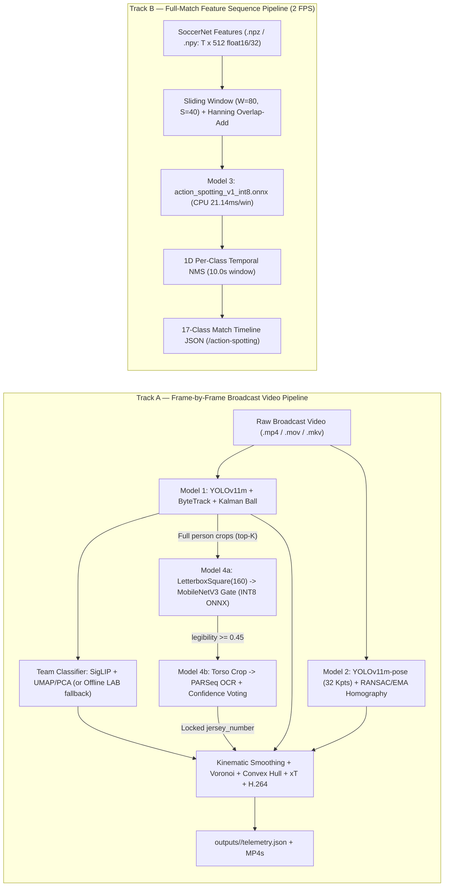

# TacticalVision AI — Scientific Model Cards & Architecture Specifications

**Technical documentation for the 4-Model Unified Football Intelligence Suite (`YOLOv11m` · `YOLOv11m-pose` · `Dilated-TCN + Bi-GRU + Attention` · `MobileNetV3-Large + PARSeq`).**

[Executive Matrix](#master-4-model-executive-matrix) · [System Dataflow](#system-dataflow) · [Model 1](#model-1--match-entity-detector) · [Model 2](#model-2--32-keypoint-pitch-homography) · [Model 3](#model-3--17-class-action-spotting) · [Model 4](#model-4--jersey-legibility-gate--parseq-ocr) · [Calibration](#production-calibration--kinematic-smoothing)

---

📖 ملخص علمي لمنظومة النماذج الأربعة بالعربية (Arabic Model Suite Summary)

توثق هذه البطاقة العلمية المواصفات الهندسية، ومعايير التدريب، ونتائج التقييم المخبرية الحقيقية لمنظومة النماذج الأربعة في **TacticalVision AI**:

1. **النموذج الأول (رصد عناصر المباراة):** شبكة `YOLOv11m` بدقة `1280px` لرصد اللاعبين وحراس المرمى والحكام والكرة بمعدل `mAP@50` إجمالي بلغ **`89.76%`** (`99.43%` للاعبين) مقارنةً بـ **`77.77% F1`** للاعبين فقط و `0%` لبقية الفئات في نموذج COCO الأساسي.
2. **النموذج الثاني (نقاط الملعب الـ 32 والـ Homography):** شبكة `YOLOv11m-pose` بدقة `640px` لاستخراج 32 معلم هندسي للملعب بمعدل `Pose mAP@50 = 92.55%` و `PCK@20px = 86.77%` وجاهزية إسقاط `97.06%`.
3. **النموذج الثالث (رصد الأحداث التكتيكية الـ 17):** شبكة زمنية خفيفة (`2.94M` معامل) مبنية من `Multi-Scale Dilated TCN + 2L Bi-GRU + 4H Self-Attention` تعمل على متجهات `ResNet-PCA512` بسرعة `2 FPS` وتُحقق `Loose a-mAP = 62.63%` و `Tight a-mAP = 47.95%` بزمن استدلال CPU يبلغ **`21.14 ms`** عبر نسخة `INT8 ONNX`.
4. **النموذج الرابع (بوابة وضوح القميص والتعرف على الرقم):** شبكة `mobilenetv3_large_100` (`4.2M` معامل) تُصفّي لقطات اللاعبين قبل تمرير منطقة الجذع إلى `PARSeq OCR` وتُحقق `Crop F1 = 90.47%` وبزمن **`11.16 ms`** على المعالج بنسخة `INT8 ONNX`، مع رفع دقة خط القراءة الإجمالية من `42.67%` إلى `49.33%` ورفع رفض اللقطات غير المقروءة إلى `65.96%`.

---

## Master 4-Model Executive Matrix

All values below are verified directly against [`artifacts/models_meta/master_metrics_report.json`](../artifacts/models_meta/master_metrics_report.json), [`artifacts/models_meta/cpu_onnx_benchmarks.json`](../artifacts/models_meta/cpu_onnx_benchmarks.json), and [`artifacts/models_meta/models_registry.json`](../artifacts/models_meta/models_registry.json).

| Model | Task & Domain | Architecture | Params / Artifact Size (ONNX) | Primary Evaluation Metric | CPU ONNX Latency (FP32 → INT8) | Platform Role |
| :--- | :--- | :--- | :--- | :--- | :--- | :--- |
| **Model 1** (`players_best`) | 4-class match object detection (`ball`, `goalkeeper`, `player`, `referee`) | Fine-tuned `YOLOv11m` (`1280×1280`) | `38.71 MB` (`.pt`) / `77.19 MB` (`.onnx`) | **`89.76%`** `mAP@50` (`99.43%` player `mAP@50`) | `4,421.21 ms` (`0.2 FPS`) FP32 *(no INT8 exported)* | Per-frame bounding boxes & ByteTrack input |
| **Model 2** (`pitch_best`) | 32-keypoint FIFA pitch geometry landmark detection | Fine-tuned `YOLOv11m-pose` (`640×640`) | `41.31 MB` (`.pt`) / `82.09 MB` (`.onnx`) | **`92.55%`** Pose `mAP@50` (`97.06%` homography-ready) | `1,213.43 ms` (`0.8 FPS`) FP32 *(no INT8 exported)* | RANSAC planar homography `105m × 68m` projection |
| **Model 3** (`action_spotting_v1`) | 17-class SoccerNet temporal action spotting (`2 FPS`) | `Dilated ResTCN (d=1,2,4,8)` + `2L Bi-GRU` + `4H MHA` | `2.94M` params / `11.24 MB` FP32 · `9.11 MB` INT8 | **`62.63%`** Loose a-mAP · **`47.95%`** Tight a-mAP | `22.74 ms` (`44.0 FPS`) → **`21.14 ms` (`47.3 FPS`)** | Full-match 45-min half event timeline (`/action-spotting`) |
| **Model 4** (`jersey_legibility_v1`) | Binary jersey legibility gate + torso `PARSeq` OCR | `MobileNetV3-Large-100` gate + pretrained `PARSeq` | `4.20M` params / `16.03 MB` FP32 · `16.04 MB` INT8 | **`90.47%`** Crop F1 · **`85.97%`** Tracklet F1 (`99.53%` recall) | `14.20 ms` (`70.4 FPS`) → **`11.16 ms` (`89.6 FPS`)** | Tracklet jersey number verification (`#22 ✓`) |

> **Parity Check:** Both Model 3 (`action_spotting_v1.onnx`) and Model 4 (`jersey_legibility_v1.onnx`) passed PyTorch-to-ONNX numerical parity verification with `pytorch_onnx_max_abs_diff = 0.0` (under threshold `5e-3`).

---

## System Dataflow

TacticalVision AI operates two complementary inference tracks that converge inside the Next.js Studio UI:

---

## Verified ONNX Tensor Contracts

Inspected directly from the binary ONNX protobuf headers (`ir_version = 8`, `opset_import = 17`):

| Model File | Input Name | Input Shape | Input Dtype | Output Name | Output Shape | Output Dtype | Sigmoid Included in Graph? |
| :--- | :--- | :--- | :--- | :--- | :--- | :--- | :--- |
| `players_best.onnx` | `images` | `[1, 3, 1280, 1280]` | `FLOAT` (`float32`) | `output0` | `[1, 8, 33600]` | `FLOAT` (`float32`) | YOLO raw head (`[x,y,w,h, 4 cls]`) |
| `pitch_best.onnx` | `images` | `[1, 3, 640, 640]` | `FLOAT` (`float32`) | `output0` | `[1, 101, 8400]` | `FLOAT` (`float32`) | YOLO-pose head (`4 + 1 + 32*3`) |
| `action_spotting_v1.onnx` | `features` | `['batch', 'time', 512]` | `FLOAT` (`float32`) | `event_probs` | `['batch', 'time', 17]` | `FLOAT` (`float32`) | **Yes** (`ActionSpottingONNXWrapper` applies `torch.sigmoid`) |
| `action_spotting_v1_int8.onnx` | `features` | `['batch', 'time', 512]` | `FLOAT` (`float32`) | `event_probs` | `['batch', 'time', 17]` | `FLOAT` (`float32`) | **Yes** (dynamic `QUInt8` on `MatMul`, `Gemm`) |
| `jersey_legibility_v1.onnx` | `image` | `['batch', 3, 160, 160]` | `FLOAT` (`float32`) | `legibility_prob` | `['batch']` | `FLOAT` (`float32`) | **Yes** (`JerseyLegibilityONNXWrapper` applies `torch.sigmoid`) |
| `jersey_legibility_v1_int8.onnx` | `image` | `['batch', 3, 160, 160]` | `FLOAT` (`float32`) | `legibility_prob` | `['batch']` | `FLOAT` (`float32`) | **Yes** (dynamic `QUInt8` on `MatMul`, `Gemm`) |

> **Critical Implementation Guard:** Both `action_spotting_v1*.onnx` and `jersey_legibility_v1*.onnx` already output post-sigmoid probabilities in `[0, 1]`. Runtime wrappers **must never apply `sigmoid` a second time**.

---

## Model 1 — Match Entity Detector

### Architecture & Calibration
- **Backbone:** Fine-tuned `YOLOv11m` (`38.71 MB` PyTorch, `77.19 MB` FP32 ONNX) trained at `imgsz=1280` for four football classes: `{0: ball, 1: goalkeeper, 2: player, 3: referee}`.
- **Dataset Scope (`reports/metrics_report.json`):** `612` train images (`14,583` boxes), `38` val images (`905` boxes), `13` test images (`310` boxes); `13,241` player, `1,519` referee, `565` ball (median `11.0 × 11.8 px`, scaling to `7.3 px` at `1280 px` vs only `3.7 px` at `640 px`), and `473` goalkeeper annotations.
- **Thresholds (`optimal_thresholds_v1.json`):** Validation F1-calibrated class thresholds `{ball: 0.35, goalkeeper: 0.50, player: 0.60, referee: 0.45}`, `nms_iou = 0.50`. In video inference, `production_tuning.model_1_players` permits `det_conf = 0.35` with `ByteTrack` temporal persistence and `KalmanBallTracker` gating.

### Fine-Tuned vs. COCO Pretrained Baseline (`IoU = 0.50`)

| Class | COCO Zero-Shot (`640px`) F1 | Fine-Tuned (`1280px`) Precision | Fine-Tuned Recall | Fine-Tuned F1 | Fine-Tuned `mAP@50` | Fine-Tuned `mAP@50-95` |
| :--- | :---: | :---: | :---: | :---: | :---: | :---: |
| **Ball** (`0`) | `0.00%` (0/35) | `95.45%` | `60.00%` | **`0.7368`** | `63.33%` | `35.27%` |
| **Goalkeeper** (`1`) | `0.00%` (0/27) | `96.30%` | `96.30%` | **`0.9630`** | `97.82%` | `82.24%` |
| **Player** (`2`) | `77.77%` | `99.33%` | `98.81%` | **`0.9907`** | `99.43%` | `83.48%` |
| **Referee** (`3`) | `0.00%` (0/89) | `98.88%` | `98.88%` | **`0.9888`** | `98.46%` | `71.97%` |
| **Overall** | — | — | — | — | **`89.76%`** | **`68.24%`** |

### Known Limitations & Mitigations
- **Small Ball Scale & Motion Blur:** At `1280px`, the median ball width is `7.3 px`, causing `14/35` missed ball detections in static validation (`ball_missed_val_frames = 14`). Mitigated in video by lowered ball detection sensitivity (`0.22–0.35`) paired with `KalmanBallTracker` and parabolic interpolation up to `12` frames.
- **CPU Resolution vs. Speed Trade-off:** Native `1280px` ONNX runs at `4,421.21 ms/frame` on CPU; `cpu_quick` mode uses `det_imgsz = 640` via PyTorch Ultralytics for rapid CPU turnaround while retaining full `1280px` on CUDA / remote GPU workers.

---

## Model 2 — 32-Keypoint Pitch Homography

### Architecture & Calibration
- **Backbone:** `YOLOv11m-pose` (`kpt_shape = [32, 3]`, `41.31 MB` `.pt`, `82.09 MB` `.onnx`) predicting 32 canonical FIFA `105m × 68m` pitch landmarks (`pitch_imgsz = 640` or `512` in CPU quick-scan).
- **Dataset Scope:** `255` train, `34` val, `28` test frames; median `16.0` visible keypoints per image (`100%` of audited images contain `≥ 4` visible keypoints).
- **Geometric Projection (`StabilizedHomography`):** Solves `cv2.findHomography(..., cv2.RANSAC, 5.0)` over keypoints passing `kpt_conf`, spatial spread checks (`min_span_m`), convex-hull span gates (`min_convex_hull_area_m2`), reprojection error gating (`max_reproj_error_m`), and Exponential Moving Average smoothing (`ema_alpha`).

### Validation Evaluation Metrics (`master_metrics_report.json`)

| Metric | Value | Notes |
| :--- | :---: | :--- |
| **Pose `mAP@50`** | **`92.55%`** | `Pose mAP@50-95 = 37.71%` |
| **Mean / Median Pixel Error** | **`13.86 px` / `10.35 px`** | Over visible pitch landmarks |
| **PCK @ `5px` / `10px` / `20px`** | `17.74%` / `47.74%` / **`86.77%`** | Percentage of Correct Keypoints |
| **Homography-Ready Frames** | **`97.06%`** | Frames with `≥ 4` valid RANSAC points |
| **Mean RANSAC Reprojection Error** | `32.81 px` | Pre-EMA raw single-frame RANSAC validation residual |

### Known Limitations & Mitigations
- **Tight Midfield Zoom / Occluded Lines:** When broadcast cameras zoom closely on central midfield, fewer than `4–5` landmarks remain visible or points cluster linearly, causing homography instability or edge clamping (`-2.0` / `107.0` m).
- **Two-Layer Defense:** (1) Tightened engine gating (`max_reproj_error_m = 2.5m`, `min_span_m = 15.0m`, `min_convex_hull_area_m2 = 150.0m²`, `ema_alpha = 0.2`); (2) Frontend [`radarStabilizer.ts`](../frontend/src/lib/radarStabilizer.ts) whole-frame sentinel rejection + short-gap kinematic bridging.

---

## Model 3 — 17-Class Action Spotting

### Architecture & Training Strategy
- **Network (`TacticalActionSpotter`, `2.94M` params):**
  1. **Input Projection:** `Linear(512 → 256) + LayerNorm + GELU + Dropout(0.15)` over `2 FPS` `ResNet-TF2 PCA-512` feature sequences.
  2. **Multi-Scale Temporal Convolutions:** 4 sequential `DilatedResTCNBlock` layers with dilation rates `d = (1, 2, 4, 8)`, `Conv1d(k=3)`, `GroupNorm(8)`, `GELU`, and channel `TemporalSEBlock` squeeze-and-excitation gating.
  3. **Sequence Modeling & Global Context:** 2-layer bidirectional GRU (`hidden = 128` per direction, residual skip + `LayerNorm`) followed by 4-head `MultiheadAttention` + FFN transformer block over `40s` (`80`-frame) windows.
  4. **Dual Heads & Export Wrapper:** Primary frame-level head `(B, T, 17)` initialized with bias `-3.5` (positive-prior ~`0.02`) + auxiliary attention-pooled clip head (`weight = 0.35`). For ONNX export, `ActionSpottingONNXWrapper` exposes `torch.sigmoid(frame_logits)` cleanly.
- **Training Regime (`trainer_action_spotting.py`):** SoccerNet-v2 `float16` feature sequences (game-level split leakage check = `0` overlapping matches); `SoftTargetFocalBCELoss(alpha=0.75, gamma=2.0)` with Soft Gaussian temporal targets (`sigma = 2.0` frames / `1.0s`); inverse-power class sampling (`1 / count^0.35`); temporal Mixup (`p=0.30, alpha=0.25`); feature noise (`sigma=0.03`), temporal block masking, and channel masking; `AdamW(lr=1.2e-3, wd=1e-2)` + CosineAnnealingLR (`45` epochs, EMA decay `0.995`).
- **Inference & Post-Processing:** Overlapping sliding window (`W = 80` frames = `40s`, `stride = 40` frames = `20s`) blended with a clipped Hanning window (`np.clip(np.hanning(80), 0.15, 1.0)`), followed by per-class 1D Temporal NMS (`nms_window_sec = 10.0s`, production default `min_conf = 0.35`).

### Held-Out Test Set Evaluation (`master_metrics_report.json`)

| Metric | Validation (Epoch 45) | Held-Out Test |
| :--- | :---: | :---: |
| **Tight a-mAP (`δ = 1s..5s`)** | `47.74%` | **`47.95%`** |
| **Loose a-mAP (`δ = 5s..60s`)** | `61.60%` | **`62.63%`** |
| **mAP @ `1s` / `5s`** | `29.85%` / `55.86%` | **`29.76%` / `56.14%`** |

Complete Per-Class Tight AP (%) Across All 17 SoccerNet Classes (Held-Out Test)

| Class ID | Event Class | Tight AP (%) | Class ID | Event Class | Tight AP (%) |
| :---: | :--- | :---: | :---: | :--- | :---: |
| `0` | Penalty | `79.72%` | `9` | Throw-in | `50.11%` |
| `1` | Kick-off | `33.00%` | `10` | Foul | `53.30%` |
| `2` | **Goal** | **`80.07%`** | `11` | Indirect free-kick | `30.05%` |
| `3` | Substitution | `36.64%` | `12` | Direct free-kick | `65.74%` |
| `4` | Offside | `32.68%` | `13` | **Corner** | **`78.92%`** |
| `5` | Shots on target | `39.79%` | `14` | Yellow card | `52.23%` |
| `6` | Shots off target | `45.49%` | `15` | Red card | `4.71%` |
| `7` | Clearance | `48.86%` | `16` | Yellow→red card | `1.73%` |
| `8` | Ball out of play | `65.09%` | — | **Mean (Tight a-mAP)** | **`47.95%`** |

### Known Limitations & Mitigations
- **Feature-Space Input Requirement:** Model 3 expects pre-extracted `2 FPS` `(T, 512)` `ResNet-TF2 PCA-512` feature matrices (`.npz` / `.npy`), **not** raw RGB broadcast pixels. Running Model 3 on arbitrary user MP4 clips requires a compatible upstream 512-D feature extractor; currently Model 3 powers full-match SoccerNet feature analysis (`test_000.npz` demo + uploaded `.npz`/`.npy` files).
- **Extreme Class Imbalance on Cards:** Rare events such as `Red card` (`4.71%` AP) and `Yellow->red card` (`1.73%` AP) have very sparse support in SoccerNet splits compared to `Goal` (`80.07%`), `Penalty` (`79.72%`), and `Corner` (`78.92%`). Interactive confidence sliders in the UI allow analysts to adjust operating thresholds dynamically per scenario.

---

## Model 4 — Jersey Legibility Gate & PARSeq OCR

### Architecture & Two-Stage Pipeline
1. **Stage 1 — Legibility Gate (`JerseyLegibilityNet`, `4.20M` params):** `timm` `mobilenetv3_large_100` backbone + `Dropout(0.25) + Linear` binary head trained on SoccerNet `jersey-2023` tracklets (top-sharpness crops selected via torso-region Laplacian variance, strict tracklet-level zero-leakage split).
   - **Preprocessing (`LetterboxSquare(160)`):** Preserves aspect ratio of full person crops on dark pad `(20, 26, 22)` normalized with ImageNet mean/std, avoiding digit squashing; training explicitly **disables horizontal flip** and applies broadcast motion blur + JPEG (`q=48..92`) degradation + label smoothing (`0.08`).
   - **Training Calibration:** Selected Epoch 12 (`21.88 min` training), optimal crop threshold calibrated at `0.25` (production runtime tightens gating threshold to `0.45` in `models_registry.json` to suppress false OCR reads).
2. **Stage 2 — Torso Crop + Pretrained `PARSeq` OCR + Tracklet Voting:**
   - **Critical Alignment Rule:** Stage 1 (`jersey_legibility_v1_int8.onnx`) runs on the **full player bounding box** (`LetterboxSquare(160)`). Passing crops (top-5 per tracklet, `max_crops_per_track = 12`) are then sliced cleanly to the **torso box** `[x1=0.20, y1=0.18, x2=0.80, y2=0.56]` before resizing (`BICUBIC`, `Normalize(0.5, 0.5)`) for pretrained `PARSeq` scene-text decoding (`baudm/parseq`, valid range `1..99`), aggregated per `track_id` via confidence-weighted voting (`leg_score * ocr_conf`).

### Held-Out Test Set Metrics & Ablation (`300` Tracklets: `206` Legible, `94` Illegible)

| Evaluation Level / Pipeline Variant | ROC-AUC | PR-AUC | F1 / Overall Acc | Precision / Legible Acc | Recall / Illegible Rejection |
| :--- | :---: | :---: | :---: | :---: | :---: |
| **Legibility Gate — Crop Level** (`th = 0.25`) | `84.27%` | `88.53%` | **`90.47%`** F1 | `85.04%` | `96.64%` |
| **Legibility Gate — Tracklet Top-3 Mean** | `83.62%` | — | **`85.97%`** F1 | `75.67%` | **`99.53%`** (`[81, 273; 4, 849]`) |
| **PARSeq Ablation — Raw PARSeq (No Gate)** | — | — | `42.67%` Acc | `38.83%` | `51.06%` |
| **PARSeq Ablation — Full Gated Pipeline** | — | — | **`49.33%` Acc** (`+6.66 pp`) | **`41.75%` Acc** | **`65.96%` Reject** (`+14.90 pp`) |

### Known Limitations & Mitigations
- **Low-Resolution & Oblique Occlusions:** Even after legibility gating (`65.96%` illegible rejection), distorted or tiny distant player jerseys (`< 24 px` torso width) can confuse digit pairs (e.g., `14 → 38` at `0.097` OCR conf in `parseq_ablation_report.json`). Mitigated by `min_track_ocr_conf = 0.18`, `parseq_min_crop_conf = 0.35`, and multi-frame tracklet voting across up to `12` frames.
- **Offline / Missing `strhub` Graceful Degradation:** Pretrained `PARSeq` requires `timm`/`strhub` and an initial `torch.hub` download when not cached. When unavailable (or in offline `cpu_quick` mode without cached weights), the engine cleanly runs the `INT8` ONNX legibility gate alone (recording crop legibility diagnostics) while setting `jersey_number = null` and falling back to `#TrackID` badges without crashing.

---

## Production Calibration & Kinematic Smoothing

Recorded in [`artifacts/models_meta/models_registry.json`](../artifacts/models_meta/models_registry.json) under `production_tuning`:

| Parameter Group | Verified Production Settings | Purpose |
| :--- | :--- | :--- |
| **Model 2 Homography** | `kpt_conf=0.30`, `pitch_stride=2`, `min_span_m=15.0`, `min_convex_hull_area_m2=150.0`, `max_reproj_error_m=2.5`, `ema_alpha=0.20` | Reject collinear/collapsed landmark frames and damp camera pan jitter at source |
| **Kinematics Smoothing** | `position_moving_avg_window=7`, `speed_window_frames=10`, `speed_median_filter=5`, `max_valid_speed_kmh=35.5` | Eliminate single-frame homography spikes from speed & sprint telemetry |
| **Model 3 Spotting** | `preferred_file="action_spotting_v1_int8.onnx"`, `fps=2`, `window_frames=80`, `stride_frames=40`, `nms_window_sec=10.0`, `min_conf=0.35` | Real-time CPU half-match inference (`21.14 ms/window`) |
| **Model 4 Recognition** | `preferred_legibility_file="jersey_legibility_v1_int8.onnx"`, `legibility_threshold=0.45`, `min_track_ocr_conf=0.18`, `max_crops_per_track=12`, `torso_crop_box=[0.2, 0.18, 0.8, 0.56]`, `parseq_min_crop_conf=0.35` | Minimize false jersey numbers and lock consistent `#Jersey` identity per tracklet |
